<style>
    p {
        text-indent: 2em; /* 首行缩进2字符 */d
    }
</style>

### STL中`push_back`和`emplace_back`的区别
**核心区别**

| 特性 | `push_back` | `emplace_back` |
|------|-------------|----------------|
| **参数** | 接受对象本身 | 接受构造函数的参数 |
| **构造次数** | 1次构造 + 1次拷贝/移动 | 1次直接构造 |
| **临时对象** | 可能产生临时对象 | 不产生临时对象 |
| **效率** | 较慢（可能多一次拷贝） | 更快（直接构造） |
| **适用版本** | C++98 起 | C++11 起 |

**基本用法对比**

```cpp
#include <vector>
#include <string>

struct Person {
    std::string name;
    int age;
    
    Person(const std::string& n, int a) : name(n), age(a) {
        std::cout << "构造: " << name << std::endl;
    }
    
    Person(const Person& other) : name(other.name), age(other.age) {
        std::cout << "拷贝构造: " << name << std::endl;
    }
    
    Person(Person&& other) noexcept : name(std::move(other.name)), age(other.age) {
        std::cout << "移动构造: " << name << std::endl;
    }
};
```

- 默认使用`emplace_back`，更灵活高效
- **不可拷贝类型**只能用`emplace_back`
- 初始化列表场景可以使用`push_back`
- `noexcept`声明函数不返回任何异常(比如不生成栈展开的额外代码)。移动语义本质为指针所有权转移，不涉及新的内存分配，因此一般不会抛出异常。`std::vector`扩容时，如果移动构造函数是`noexcept`，优先使用移动语义；如果不是则退化为拷贝语义。

| 类型 | 符号 | 含义 |
| :-- | :-- | :-- |
| 左值引用 | `T&` | 指向可寻址、有名字的变量 |
| 右值引用 | `T&&` | 指向即将销毁的临时对象 |
| 常引用 | `const T&` | 能绑定左或右值，但只能读 |

*指针相关方法*
**get和move**
| 特性 | `get()` | `move()` |
| :-- | :-- | :-- |
| 作用对象 | 智能指针 | 任意对象 |
| 目的 | 获取原始指针 | 将对象转为右值引用 |
| 所有权 | 不转移所有权 | 移动语义，转移资源 |
| 返回值 | 原始指针 | 右值引用 |
| 使用场景 | 访问原始指针，但不转移所有权 | 移动构造、移动赋值 |

```cpp
auto p = std::make_unique<int>(10);

int* raw = p.get();

cout << *raw;
```
不要使用`delete raw`，否则会面临双重析构的问题

`release`:释放所有权
```cpp
auto p = std::make_unique<int>(10);

int* raw = p.release();
```
此时`p == nullptr`但是`raw`依旧存在，需要手动`delete`

`reset`销毁当前对象
```cpp
p.reset()
// 相当于
delete 原对象
p=nullptr
```

**写一个类的复制拷贝函数(深拷贝问题)**
```cpp
class MyClass{
private:
    char* data;
public:
// 构造函数
    MyClass(const char* str = "") : data(nullptr) {
        data = new char[strlen(str)+1];
        strcpy(data, str);
    }
// 拷贝构造
    MyClass(const MyClass& idx) : data(nullptr) {
        data = new char[strlen(idx.data)+1];
        strcpy(data, idx.data);
    }
// 重载赋值运算符
    MyClass& operator=(const MyClass& other) {
        if (this != &other) {
            delete[] data;
            data = new char[strlen(other.data)+1];
            strcpy(data, other.data);
        }
        return *this;
    }
// 析构
    ~MyClass(){
        delete[] data;
    }
/**
* MyClass的构造函数保证MyClass对象的data指向一个有效内存
* 这个内存至少为{'\0'}
* 但是在构造函数和拷贝构造中，将data初始化为nullptr
* 这样可以避免data为未定义的随机值（野指针）
* 如果new抛出异常，析构函数会执行`delete[] data`
* 由于此时data为野指针，将会发生未定义行为造成崩溃
*/
};
```

memcpy可以用于任意形式的拷贝strcpy则只适用于字符串
```cpp
// 使用 strcpy：只能处理以 '\0' 结尾的字符串
strcpy(data, other.data);

// 使用 memcpy：可以处理任意二进制数据
memcpy(data, other.data, len);
```

```cpp
MyClass& operator=(const MyClass& other) {
    if (this != &other) {
        delete[] data;
        size_t len = strlen(other.data) + 1;  // 必须提前算长度
        data = new char[len];
        memcpy(data, other.data, len);        // 替换 strcpy
    }
    return *this;
}
```

new和new[]会在内存中记录不同元数据，后者会在内存块头部记录数组大小（元素个数），delete[]会读取这个信息逐个调用析构函数；delete只会调用第一个元素的析构函数

### `map`和`unordered_map`的区别及使用场景
| 特性 | `std::map` | `std::unordered_map` |
|------|------------|----------------------|
| **底层实现** | 红黑树（平衡二叉搜索树） | 哈希表 |
| **元素顺序** | 按键自动排序（升序） | 无序 |
| **查找复杂度** | O(log n) | O(1) 平均，O(n) 最坏 |
| **插入复杂度** | O(log n) | O(1) 平均，O(n) 最坏 |
| **删除复杂度** | O(log n) | O(1) 平均，O(n) 最坏 |
| **空间占用** | 较小（每个节点多存指针） | 较大（需要哈希表数组） |
| **迭代器类型** | 双向迭代器 | 前向迭代器 |
| **内存布局** | 节点分散 | 桶连续 + 节点分散 |
| **适用版本** | C++98 起 | C++11 起 |

### map中的key按照自定义排序
`std::map`的模板定义：
```cpp
template<class Key, class T, class Compare = std::less<key>>
class map
```
其中`compare`就是key的排序比较器，默认形式为`std::less<key>`升序

**自定义方法**
1. 函数对象
   ```cpp
    #include <iostream>
    #include <map>
    #include <string>

    // 自定义比较器：按字符串长度降序（长 -> 短）
    struct CompareByLengthDesc {
        bool operator()(const std::string& a, const std::string& b) const {
            if (a.length() != b.length()) {
                return a.length() > b.length();  // 长度降序
            }
            return a < b;  // 长度相同时按字典序
        }
    };

    int main() {
        std::map<std::string, int, CompareByLengthDesc> myMap;
        
        myMap["apple"] = 1;
        myMap["banana"] = 2;
        myMap["cat"] = 3;
        myMap["dog"] = 4;
        
        for (const auto& [key, value] : myMap) {
            std::cout << key << ": " << value << std::endl;
        }
        // 输出顺序：banana (6), apple (5), cat (3), dog (3)
        // 注：cat 和 dog 长度相同，按字典序 cat < dog
        
        return 0;
    }
    ```
    在`return a < b`中，判断的是a、b的字典序，而非其值大小。`<`为`std::string`运算符，用途是逐个字符比较a和b的ASCII码

    `std::map`的第三个模板参数只作用于键，不涉及值
2. Lambda表达式
   ```cpp
   #include <iostream>
   #include <map>
   #include <string>

   int main() {
    // 定义lambda表达式
    auto cmp = [](const std::string& a, const std::string& b) {
        if (a.length() != b.length()) {
            return a.length() > b.length();  // 长度降序排列
        }
        return a < b;
    };
    // 使用decltype自动推导lambda类型，传入lambda对象
    std::map<std::string, int, decltype(cmp)> myMap(cmp);

    myMap["apple"] = 1;
    myMap["banana"] = 2;
    myMap["cat"] = 3;
    
    for (const auto& [key, value] : myMap) {
        std::cout << key << ": " << value << std::endl;
    }
    // 输出：banana: 2, apple: 1, cat: 3
    
    return 0;
   }
   ```
3. 函数指针
### 手撕memcpy
```cpp
# include <cstddef>     // std::size_t

void* my_memcpy(void* dest, const void* src, std::size_t count) {
    void* result = dest;
    // 判断无效情况
    if (dest == nullptr || src == nullptr || count = 0) {
        return result;
    }
    // 使用无符号字符（1字节）避免符号扩展问题
    unsigned char* d = static_cast<unsigned char*>(dest);
    const unsigned char* s = static_cast<const unsigned char*>(src);
    // 得到复制和源的低地址，判断是否存在风险区域
    if (d < s) {
        // 无风险
        for (std::size_t i = 0; i < count; i++) {
            d[i] = s[i];
        }
    } else {
        // 需从高位开始
        for (std::size_t i = count-1; i >=0; i--) {
            d[i] = s[i];
        }
    }
    return result;
}
```
`size_t`是C++中专门用于表示对象大小、数组长度的**无符号整数**类型，通常由`sizeof`返回。一般用于表示内存大小、数组索引、循环大小。在此例中，`size_t`用于表示内存中的字节数量。`sizeof`,`strlen`,`malloc`等内存相关标准库函数均采用`size_t`

### 谈谈STL
基于模板技术实现，提供大量可服用数据结构和算法
**容器**
用于储存数据

- 顺序容器：`vector`,`deque`,`list`,`forward_list`
- 关联容器：`set`,`map`,`multiset`,`multimap`
底层通常使用红黑树实现。自动有序。查找、插入、删除时间复杂度为O(logN)
- 无序关联容器：`unorderde_map`,`unordered_set`,`unordered_multimap`,`unordered_multiset`
底层使用哈希表。查找插入平均复杂度O(1)

1. 算法
```text
sort()
find()
count()
binary_search()
lower_bound()
upper_bound()
for_each()
remove()
reverse()
```

`binary_search`对有序序列进行二分查找，默认序列升序排列
```cpp
#include <iostream>
#include <vector>
#include <algorithm>
using namespace std;

int main() {
    vector<int> v = {1, 3, 5, 7, 9, 11};
    
    bool found = binary_search(v.begin(), v.end(), 7);
    cout << (found ? "找到了" : "没找到") << endl;  // 输出：找到了
    
    found = binary_search(v.begin(), v.end(), 4);
    cout << (found ? "找到了" : "没找到") << endl;  // 输出：没找到
    
    return 0;
}
```

`lower_bound`返回有序序列中第一个“不小于”目标值的位置；`upper_bound`返回有序序列中第一个“大于”目标值的位置

在降序序列中，需要使用lambda表达式来制定规则，如：
```cpp
#include <iostream>
#include <vector>
#include <algorithm>
using namespace std;

int main() {
    vector<int> v = {9, 7, 5, 3, 1};  // 降序排列
    
    // 查找第一个不大于 5 的位置（即 <= 5）
    auto it = lower_bound(v.begin(), v.end(), 5, [](const int& a, const int& b) {
        return a > b;  // 表示序列是降序
    });
    
    cout << "第一个不大于5的位置: " << (it - v.begin()) << endl;  // 输出 2（指向5）
    cout << "该位置的元素: " << *it << endl;  // 输出 5
    
    return 0;
}
```

以上为常用通用算法
3. 迭代器
4. 仿函数
5. 适配器:对已有容器进行封装
典型用例
```text
stack
queue
priority_queue
```
**容器适配器**不像容器一样**提供完整数据存储结构和丰富接口**，只**封装底层容器、提供受限接口**

6. 分配器：负责内存管理

### 哈希表及其原理

哈希表（Hash Table）是一种根据键（Key）直接访问数据的数据结构，其核心思想是通过哈希函数将键映射到数组中的某个位置，从而实现快速的查找、插入和删除操作。

哈希表主要由两部分组成：
1. 哈希函数（Hash Function）
2. 存储数据的桶（Bucket）数组

其工作过程如下：

当插入一个键值对时，首先通过哈希函数计算键对应的哈希值，然后根据哈希值确定元素应该存储的位置。例如：

查找时同样先计算哈希值，然后直接定位到对应桶，从而避免遍历整个容器，因此平均时间复杂度为 O(1)。

哈希冲突（Hash Collision）：不同的 Key 经过哈希计算后得到相同的位置。
```text
1 % 10 = 1
11 % 10 = 1
21 % 10 = 1
```
多个元素都会映射到同一个桶。

解决哈希冲突的方法：
1. 链地址法
每个桶维护一个链表或其他容器，发生冲突的元素挂接在同一个桶后面
```text
bucket[1]
   ↓
[1] -> [11] -> [21]
```
C++ STL 中的 unordered_map 和 unordered_set 通常采用这种思想实现。

2. 开放寻址法
发生冲突后不使用链表，而是在数组中继续寻找空闲位置。

### 介绍vector和list的区别

`vector` 和 `list` 都是 STL 中常用的容器，但它们的底层实现和适用场景有较大区别。

首先，`vector` 的底层是**动态数组**，而 `list` 的底层是**双向链表**。

1. 底层结构

#### vector

```text
+----+----+----+----+----+
| 1  | 2  | 3  | 4  | 5  |
+----+----+----+----+----+
```

特点：

* 内存连续存储
* 支持随机访问
* 可以通过下标直接访问元素

例如：

```cpp
vector<int> v{1,2,3};

cout << v[1];
```

访问时间复杂度为 O(1)。

---

#### list

```text
+-----+    +-----+    +-----+
|  1  |<-->|  2  |<-->|  3  |
+-----+    +-----+    +-----+
```

每个节点包含：

```cpp
prev + data + next
```

特点：

* 内存不连续
* 节点之间通过指针连接
* 不支持随机访问

例如：

```cpp
list<int> lst;
```

不能写：

```cpp
lst[2];
```

因为链表必须从头开始逐个遍历。

---

2. 随机访问能力

#### vector

由于内存连续：

```cpp
v[i];
```

底层实际上是：

```cpp
*(begin + i)
```

时间复杂度：

```text
O(1)
```

---

#### list

链表需要逐个节点查找：

```text
head -> node1 -> node2 -> node3 ...
```

时间复杂度：

```text
O(N)
```

因此：

* vector 支持随机访问迭代器
* list 仅支持双向迭代器

很多 STL 算法（如 sort、binary_search）更适合 vector。

---

3. 插入和删除

#### vector

尾部插入：

```cpp
v.push_back(x);
```

平均：

```text
O(1)
```

但如果容量不足发生扩容：

```text
申请新空间
↓
拷贝旧数据
↓
释放旧空间
```

代价较大。

中间插入：

```cpp
v.insert(pos, x);
```

需要移动后续元素：

```text
O(N)
```

例如：

```text
1 2 3 4 5

插入到2后面

1 2 x 3 4 5
```

后面的元素都要向后移动。

**删除：**
```cpp
#include <iostream>
#include <vector>
using namespace std;

int main() {
    vector<int> v = {1, 2, 3, 4, 5};
    
    // 方法1：删除单个元素（通过迭代器）
    auto it = v.begin() + 2;  // 指向第3个元素（值为3）
    v.erase(it);
    // 结果：{1, 2, 4, 5}
    
    // 方法2：删除范围 [first, last)
    v.erase(v.begin() + 1, v.begin() + 3);
    // 删除索引1到2的元素（值为2和4）
    // 结果：{1, 5}
    
    // 打印结果
    for (int num : v) {
        cout << num << " ";
    }
    cout << endl;
    
    return 0;
}
```

---

#### list

链表插入：

```cpp
lst.insert(pos, x);
```

只需要修改几个指针：

```text
prev -> newNode -> next
```

时间复杂度：

```text
O(1)
```

删除同理：

```cpp
lst.erase(pos);
```

也是 O(1)。

因此频繁中间插入删除时，list 更有优势。

---

4. 内存占用

#### vector

每个元素只保存数据：

```text
[data]
```

额外开销很小。

---

#### list

每个节点除了数据外还需要：

```text
prev指针
next指针
```

例如 64 位系统：

```text
8B prev
8B next
```

因此链表内存开销明显更大。

---

5. 缓存友好性

这是实际项目中非常重要的一点。

#### vector

连续内存：

```text
1 2 3 4 5 6 7 8
```

CPU 预取效果好。

访问时：

```cpp
for(auto& x : v)
```

通常缓存命中率较高。

---

#### list

节点分散：

```text
node1 -> 0x1000
node2 -> 0x8000
node3 -> 0x3000
```

CPU 很难预取。

缓存命中率较低。

因此即使理论上 list 的插入删除复杂度更优，很多实际场景下 vector 依然更快。

---

6. 迭代器失效

#### vector

扩容时：

```cpp
push_back()
```

可能导致整块内存重新申请。

此时：

```cpp
iterator
pointer
reference
```

全部失效。

---

#### list

节点独立存在。

插入删除某个节点时：

```text
其它节点迭代器仍然有效
```

只有被删除节点对应的迭代器失效。

---

**总结**

| 对比项   | vector  | list  |
| ----- | ------- | ----- |
| 底层结构  | 动态数组    | 双向链表  |
| 内存布局  | 连续      | 非连续   |
| 随机访问  | O(1)    | O(N)  |
| 尾部插入  | O(1)    | O(1)  |
| 中间插入  | O(N)    | O(1)  |
| 中间删除  | O(N)    | O(1)  |
| 缓存友好  | 好       | 差     |
| 内存开销  | 小       | 大     |
| 迭代器类型 | 随机访问迭代器 | 双向迭代器 |

因此在实际开发中，如果主要需求是存储和访问数据，我通常优先选择 vector，因为它缓存友好、访问速度快；只有在需要频繁进行中间位置插入和删除，并且已经持有对应迭代器的场景下，我才会考虑使用 list。


### 堆上初始化和栈上初始化
| 特性 | 栈上初始化 | 堆上初始化 |
| :-- | :-- | :-- | :-- |
| 内存区域 | 栈Stack | 堆Heap |
| 分配速度 | 快(移动指针) | 慢(需要查找空闲内存) |
| 管理方式 | 自动管理，作用域结束自动释放 | 手动管理，需要`delete` |
| 生命周期 | 随作用域 | 手动控制 |
| 大小限制 | 较小，通常为1-8MB | 较大 |
| 分配时机 | 编译时确定大小 | 运行时动态分配 |

栈上初始化 
```cpp
// 1. 基础类型
int a = 10;
int b(20);      // 直接初始化
int c{30};      // C++11 统一初始化

// 2. 数组
int arr[10];                    // 固定大小
int arr2[5] = {1, 2, 3, 4, 5};

// 3. 对象
std::string str = "hello";
MyClass obj;
MyClass obj2(10, "test");
MyClass obj3{10, "test"};       // C++11
```
```text
// 内存布局
栈内存（高地址 → 低地址）
┌─────────────────────────────┐  ← 栈顶
│  局部变量 str                │
├─────────────────────────────┤
│  局部变量 obj                │
├─────────────────────────────┤
│  局部变量 arr[10]           │
├─────────────────────────────┤
│  main 函数返回地址           │
├─────────────────────────────┤
│  ...                        │
└─────────────────────────────┘  ← 栈底
```

堆上初始化
```cpp
// C 风格（不推荐在 C++ 中使用）
int* p = (int*)malloc(sizeof(int));
*p = 10;
free(p);

// C++ 传统方式
int* p1 = new int(10);           // 单个变量
int* p2 = new int[10];           // 数组
MyClass* obj = new MyClass();    // 对象
MyClass* obj2 = new MyClass(10, "test");

// 必须手动释放
delete p1;
delete[] p2;
delete obj;
delete obj2;

// C++14/17 推荐方式（智能指针）
std::unique_ptr<int> up = std::make_unique<int>(10);
std::unique_ptr<MyClass> uobj = std::make_unique<MyClass>(10, "test");

std::shared_ptr<MyClass> sp = std::make_shared<MyClass>(10, "test");

// 智能指针对象本身位于栈上，其所管理的对象则位于堆上

// 自动释放，无需手动 delete
```
```text
// 内存布局
堆内存（低地址 → 高地址）
┌─────────────────────────────┐
│  空闲内存块                  │
├─────────────────────────────┤
│  new MyClass 分配的内存      │ ← obj 指向这里
├─────────────────────────────┤
│  new int[10] 分配的内存      │ ← p2 指向这里
├─────────────────────────────┤
│  空闲内存块                  │
├─────────────────────────────┤
│  ...                        │
└─────────────────────────────┘

栈上（持有堆内存的指针）
┌─────────────────────────────┐
│  MyClass* obj ──────────────┼──→ 指向堆上的对象
├─────────────────────────────┤
│  int* p2 ───────────────────┼──→ 指向堆上的数组
└─────────────────────────────┘
```

### 手撕vector的resize

resize和reserve
| 操作 | `resize` | `reserve` |
| :-- | :-- | :-- |
| 改变size | 是 | 否 |
| 改变capacity | 可能(when n > capacity) | 是(增加到>=n) |
| 触发重新分配 | 仅当`n > capacity` | 同`resize` |

```cpp
#include <iostream>
#include <vector>

int main() {
    std::vector<int> vec;
    
    // 情况1：当前 size = 0, capacity = 0
    vec.resize(5);   // 5 > capacity(0) → 重新分配，构造 5 个零值元素
    std::cout << "size=" << vec.size() << ", cap=" << vec.capacity() << "\n";
    // 输出：size=5, cap=5（或更大）
    
    // 情况2：当前 size = 5, capacity = 5
    vec.resize(3);   // 3 < size → 不重新分配，销毁末尾 2 个元素
    std::cout << "size=" << vec.size() << ", cap=" << vec.capacity() << "\n";
    // 输出：size=3, cap=5（容量不变）
    
    // 情况3：当前 size = 3, capacity = 5
    vec.resize(8);   // 8 > capacity → 重新分配，容量增长到至少 8
    std::cout << "size=" << vec.size() << ", cap=" << vec.capacity() << "\n";
    // 输出：size=8, cap=10（通常翻倍策略）
}
```

`resize`逻辑
```cpp
void resize(size_t new_size) {
    if (new_size < _size) {
        // 情况1：缩小，删除多余元素
        // 析构多余的元素
        for (size_t i = new_size; i < _size; ++i) {
            _data[i].~T();  // 调用析构函数
        }
        _size = new_size;
    } else if (new_size > _size) {
        // 情况2：扩大，添加默认值
        reserve(new_size);  // 确保容量足够
        for (size_t i = _size; i < new_size; ++i) {
            new (_data + i) T();  // placement new，默认构造
        }
        _size = new_size;
    }
    // 情况3：相等，什么都不做
}
```

```cpp
#include <iostream>
#include <algorithm>
#include <stdexcept>
using namespace std;

template<typename T>
class my_vector{
private:
    T* data;
    size_t size;
    size_t capacity;
public:
    my_vector(): data(nullptr), size(0), capacity(0){}

    my_vector(size_t size): data(nullptr), size(size), capacity(0) {
        resize(n);
    }

    ~my_vector() {
        clear();
        delete[] data;
    }

    // 获取大小
    size_t size() const { return size; }
    size_t capacity() const { return capacity; }
    bool empty() const { return size == 0; }

    // 实现resize
    // todo
};
```

clear()函数用于从容器中删除所有元素。对于vector和string类型的容器.
clear()函数并不会释放内存或将元素值设为零，而是将容器的大小（size）设置为0，同时保留原有的容量（capacity）

### STL中map的底层是如何实现的？红黑树为什么是相对平衡的？为什么不选择AVL？
1. map底层使用红黑树实现，他满足：
   1. 元素按照Key自动有序
   2. 查找、插入、删除效率稳定
2. 红黑树是什么
本质：二叉搜索树
在BST基础上增加颜色属性
- 每个节点非黑即红
- 根节点必须为黑色
- 所有叶节点(**NULL空节点，即空指针对应的哨兵节点**)都是黑色
- 红色节点不能连续出现
- 从任意节点到其所有叶子节点路径上的黑色节点数量相同
3. 为什么不选AVL而是红黑树？
AVL（平衡二叉树）为一颗空树或者左右两个字数高度差绝对值不超过1，它的查找速度更快
但是，AVL树插入、删除调整更多，旋转次数更多

红黑树查找稍慢，但是插入删除快、旋转少，面对map的经典场景（频繁插入、删除、查找）具有更好的综合性能。

### 以vector的新方法为例，介绍你了解的C++11新特性
1. `push_back`和移动语义
C++11之前：
```cpp
vector<string> vec; 
string str = "hello"; 
vec.push_back(str);
```
调用拷贝构造`string(const string&);`，产生一次对象拷贝

C++11引入右值引用后：：
```cpp
vec.push_back(std::move(str));
```
调用移动构造`string(const string&&);`转移指针所有权，直接管理内部资源

2. `emplace_back`
传统`push_back`先构造临时对象，再将其拷贝/移动到vector，至少涉及一次额外对象构造
`emplace_back`直接在容器内部构造，效率更高

3. 扩容优化
C++11之前，vector扩容需要迁移旧元素，从旧空间拷贝到新空间，调用大量拷贝构造
C++11之后，如果对象支持移动构造`string(string&&)`，扩容时优先移动，成本显著降低
4. 统一初始化
以前：
```cpp
vectror<int> vec;
vec.push_back(1);
vec.push_back(2);
```
现在：
```cpp
vector<int> vec{1, 2};
```
5. 范围for循环

### 能否自己写一个RAII类？
```cpp
#include <iostream>
#include <stdexcept>
#include <cstring>

// 自定义RAII类，管理动态内存
template<typename T>
class My_unique_ptr{
private:
    T* ptr;     // 对象

public:
    // 构造函数，获取资源
    explicit My_unique_ptr(T* p = nullptr): ptr(p) {
        std::cout << "获取资源：" << ptr << std::endl;
    }
    // 析构函数，释放资源
    ~ My_unique_ptr() {
        if (ptr) {
            std::cout << "释放资源：" << ptr <<std::endl;
        }
        delete ptr;
    }
    // 禁止拷贝，防止double delete
    My_unique_ptr(const My_unique_ptr&) = delete;
    My_unique_ptr& opetator=(const My_unqiue_ptr&) = delete;
    // 移动语义，转移资源
    My_unique_ptr(My_unique_ptr&& other) noexcept : ptr(other.ptr) {
        other.ptr = nullptr;
        std::cout << "移动构造，转移所有权" << std::endl;
    }
    My_unique_ptr& operator=(My_unique_ptr&& other) noexcept {
        if (this != &other) {
            delete ptr; // 释放当前资源
            ptr = other.ptr;    // 接管新资源
            other.ptr = nullptr;
            std::cout << "移动幅值，转移所有权" << endl;
        }
        return *this;
    }
    // 5. 访问接口
    T& operator*() const { return *ptr; }
    T* operator->() const { return ptr; }
    T* get() const { return ptr; }

    // 6. 显式释放（可选）
    void reset(T* p = nullptr) {
        if (ptr != p) {
            delete ptr;
            ptr = p;
        }
    }
};

// 使用示例
class Person {
public:
    int age;

    Person(const std::string& n, int a) : name(n), age(a) {
        std::cout << "Person构造" << name << std::endl;
    }
    ~Person() {
        std::cout << "Person析构" << name << std::endl;
    }
    void speak() const {
        std::cout << "我是 " << name << "，今年 " << age << " 岁" << std::endl;
    }
};

int main() {
    std::cout << "=== 测试1：正常生命周期 ===\n";
    {
        My_unique_ptr<Person> p1(new Person("Alice", 25));
        p1->speak();  // 使用箭头运算符
        (*p1).speak(); // 使用解引用运算符
        // p1 离开作用域时自动释放
    }
    std::cout << "p1 已析构，内存已释放\n\n";

    std::cout << "=== 测试2：移动语义 ===\n";
    {
        My_unique_ptr<Person> p2(new Person("Bob", 30));
        My_unique_ptr<Person> p3 = std::move(p2);  // 移动构造，所有权转移
        
        if (p2.get() == nullptr) {
            std::cout << "p2 现在是空指针\n";
        }
        p3->speak();
        // p3 离开作用域时释放资源
    }
    std::cout << "p3 已析构，内存已释放\n\n";

    std::cout << "=== 测试3：异常安全 ===\n";
    try {
        My_unique_ptr<Person> p4(new Person("Charlie", 35));
        throw std::runtime_error("发生异常！");
        // 即使抛异常，p4 的析构函数依然会被调用
    } catch (const std::exception& e) {
        std::cout << "捕获异常: " << e.what() << std::endl;
        // p4 已经在栈展开时被析构，内存已释放
    }

    return 0;
}
```
```cpp
// before
for(vector<int>::iterator it = vec.begin();
    it != vec.end();
    ++it)
{
    cout << *it << endl;
}

// C++11：
for(auto& x : vec)
{
    cout << x << endl;
}
```

### MySql底层使用什么数据库结构？
MySql底层使用B+树：
- 所有数据都在叶子节点
- 叶子结点按顺序用双向链表连接
- 非叶子节点只存放key，不存放数据
- 树一般高2~4层
为什么B+树胖且矮？
通过在一个节点中存放大量key提高分支因子，可以显著降低树高，从而将一次查询的随机IO次数控制在很小的范围内。这种结构比手稿的二叉平衡树更适合磁盘和缓存系统

### 析构函数和构造函数是否可以抛出异常？
构造函数可以抛出异常，用于表示对象构造失败。此时已构造完成的成员会被正确析构

析构函数原则上不应抛出异常，C++11之后析构函数默认是`noexcept`，实践中需要保证期不抛异常

### 介绍一下进程和线程的区别
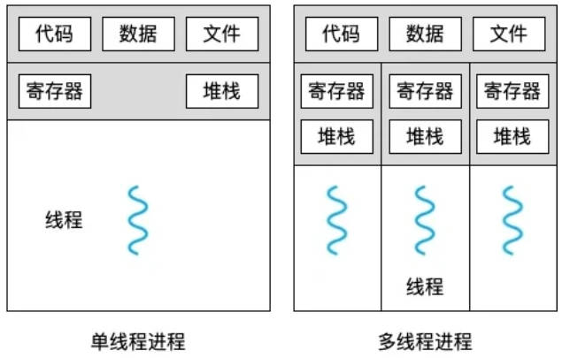

进程（Process）：
- 操作系统进行资源分配(虚拟内存、文件句柄、信号量等资源)的基本单位
- 程序的一次执行过程，拥有独立的内存空间
- 每个进程都有自己的代码段、数据段、堆栈段

线程（Thread）：
- 操作系统进行CPU调度的基本单位
- 进程内的一个执行流，共享进程的资源
- 同一个进程内的多个线程共享代码段、数据段、堆段，但有自己的栈段

进程切换：操作系统正在运行进程A、切换到进程B，操作系统需要做什么？
1. 保存A上下文
   - 保存A的CPU寄存器状态
   - 保存A的程序计数器
   - 保存A的内存管理信息
2. 切换虚拟内存空间
   - 将CPU页表基址寄存器切换为B的页表
   - 刷新TLB(地址转换缓存)(因为A的地址映射对B无效)
3. 恢复B上下文
   - 将之前B保存的寄存器、程序计数器等信息加载回CPU

进程切换为什么开销大？
TLB是CPU缓存虚拟地址到物理地址映射的“快表”。切换进程时，TLB中的缓存全部失效，CPU需要重新去内存加载页表，这个过程非常慢(涉及内存访问)

线程切换：同一个进程中有线程A和线程B。从A切换到B需要做什么？
1. 保存A的寄存器、程序计数器等
2. 恢复B的寄存器、程序计数器等

线程切换开销小，因为他不需要切换虚拟内存。同一进程的所有线程共享相同的虚拟内存空间和页表。
所以线程切换时，页表基址寄存器不用动，TLB中的缓存依然有效。
唯一要切换的，是线程私有的数据（程序计数器、寄存器、栈指针等）

### 什么是虚拟内存？
虚拟内存是一种内存管理技术，它让每个进程都以为自己拥有一个连续、完整、私有的地址空间，而实际上物理内存（RAM）是被所有进程共享的

### 多线程为什么不是越多越好？
1. 切换开销：线程的创建和切换会消耗系统资源，包括内存和CPU。如果创建太多线程，会占用大量的系统资源，导致系统负载过高，某个线程崩溃后，可能会导致进程崩溃。
2. 死锁：过多线程可能导致竞争条件和死锁。竞争条件指的是多个线程同时访问和修改共享资源，如果没有合适的同步机制，可能会导致数据不一致或错误的结果。而死锁则是指多个线程相互等待对方释放资源，导致程序无法继续执行。

```text
┌─────────────────────────────────────┐
│              进程                   │
│  ┌─────────────────────────────────┐│
│  │   代码段、数据段、堆段           │ │
│  │   (所有线程共享)                 ││
│  └─────────────────────────────────┘│
│  ┌─────┐  ┌─────┐  ┌─────┐          │
│  │线程1 │ │线程2 │ │线程3 │          │
│  │ 栈  │  │ 栈  │  │ 栈  │          │
│  └─────┘  └─────┘  └─────┘          │
└─────────────────────────────────────┘
```

### 进程有哪些状态、如何切换？
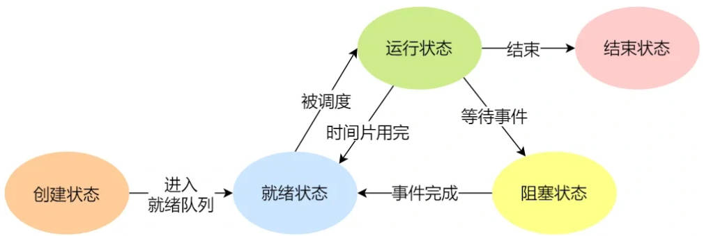
- NULL->创建状态：一个新进程被创建时的第一个状态
- 创建状态->就绪状态：进程被创建和初始化后变为就绪
- 就绪->运行：进程被操作系统进程调度器选中后分配给CPU正式运行进程
- 运行->结束：进程运行完成或出错
- 运行->就绪：进程在运行过程中，分配给它的时间片用完，操作系统将其置为就绪，从就绪态中选择其他进程运行
- 运行->阻塞：进程请求某个时间且必须等待时，比如请求I/O事件
- 阻塞->就绪：进程等待的时间完成

进程运行时间片用完或者需要插入高优先级进程时：
```text
        进程A运行中
            ↓
    【时钟中断 / 高优先级进程就绪】
            ↓
    CPU保存A的上下文到PCB_A (保存寄存器、PC等)
            ↓
    A的状态 运行→就绪
            ↓
    将A放入就绪队列尾部
            ↓
    从就绪队列取出下一个进程B
            ↓
    从PCB_B恢复B的上下文 (恢复寄存器、PC等)
            ↓
        进程B开始运行
```

### 什么是进程上下文、有哪些？
各个进程之间是共享 CPU 资源的，在不同的时候进程之间需要切换，让不同的进程可以在 CPU 执行，那么这个一个进程切换到另一个进程运行，称为进程的上下文切换。

CPU 寄存器和程序计数是 CPU 在运行任何任务前，所必须依赖的环境，这些环境就叫做**CPU上下文**

进程是由内核管理和调度的，所以进程的切换只能发生在内核态。

因此，进程的上下文切换不仅包含了虚拟内存、栈、全局变量等用户空间的资源，还包括了内核堆栈、寄存器等内核空间的资源

### 什么情况下会发生死锁？如何避免？
同时满足以下条件：
- 互斥条件：互斥条件是指多个线程不能同时使用同一个资源。
- 持有并等待条件：持有并等待条件是指，当线程 A 已经持有了资源 1，又想申请资源 2，而资源 2 已经被线程 C 持有了，所以线程 A 就会处于等待状态，但是线程 A 在等待资源 2 的同时并不会释放自己已经持有的资源 1。
- 不可剥夺条件：不可剥夺条件是指，当线程已经持有了资源 ，在自己使用完之前不能被其他线程获取，线程 B 如果也想使用此资源，则只能在线程 A 使用完并释放后才能获取。
- 环路等待条件：环路等待条件指的是，在死锁发生的时候，两个线程获取资源的顺序构成了环形链。

避免死锁的方法：
- 使用 `std::lock()` 函数一次性锁定多个互斥量，它内部采用死锁避免算法（类似银行家算法，保证全部锁定或全部不锁）
- 资源有序分配法。即线程 A 和 线程 B 获取资源的顺序要一样，当线程 A 是先尝试获取资源 A，然后尝试获取资源 B 的时候，线程 B 同样也是先尝试获取资源 A，然后尝试获取资源 B

### 共享内存是如何实现的？ 
不同进程分别拿出一块虚拟内存，映射到相同的物理内存中。

### 介绍一下TCP三次握手
TCP三次握手建立连接:
```txt
客户端（主动）                  服务器（被动）
   |                              |
   | ------ SYN (SEQ=x) --------> |  (1) 请求连接
   |                              |
   | <--- SYN+ACK (SEQ=y, ACK=x+1) |  (2) 确认并请求
   |                              |
   | --- ACK (SEQ=x+1, ACK=y+1) -> |  (3) 最终确认
   |                              |
   | ==== 连接建立，开始传输数据 ==== |
```

- **为什么不是两次握手**：如果只有两次，服务器发出确认后即认为连接建立，如果客户端没有收到，则会造成服务器资源浪费。三次握手确保双方都有收发能力
- **什么是SYN洪水攻击**：恶意客户端只发送第一次握手，不回应第三次，导致服务器挂起大量半连接，浪费资源

TCP四次握手断开连接：
```txt
主动关闭方 (Client)               被动关闭方 (Server)
   |                                    |
   | ---- FIN (SEQ=u) ----------------> | (1) 主动方说“我不发了”
   |                                    |
   | <--- ACK (SEQ=v, ACK=u+1) -------- | (2) 被动方确认，但可能还有数据要发
   |                                    |
   |      (此时被动方继续发送剩余数据)      |
   |                                    |
   | <--- FIN (SEQ=w) ---------------- | (3) 被动方说“我也发完了”
   |                                    |
   | ---- ACK (SEQ=w+1) --------------> | (4) 主动方最后确认
   |                                    |
   | (等待 2MSL 后关闭)                  | (收到ACK后立即关闭)
```

- **为什么不是三次握手**：第二次和第三次握手不能合并，被动放需要把剩余数据发完
- **TIME_WAIT状态**：主动关闭方发送随后一次ACK后，等待**2倍最大报文时间**
  - 确保被动房收到最后的ACK。如果没收到，被动方会重发FIN，主动方还能重发ACK
  - 让网络中残留的旧数据包全部消失，避免影响下一次使用相同端口的新连接

### 网络封装格式
| 层级 | 封装格式 |
| :-- | :-- |
| 应用层 | 应用数据 |
| 传输层 | TCP头-应用数据 |
| 网络层 | IP头-TCP头-应用数据 |
| 链路层 | 帧头(MAC头)-IP头-TCP头-应用数据-帧尾(FCS校验) |
| 物理层 | (进行比特流传输) |

### 介绍一下键入网址到网页显示的流程
- 浏览器解析URL，确认Web服务器和文件名，生成`HTTP`请求
- DNS查询真实地址
  - 浏览器解析URL、生成HTTP消息后，需要委托操作系统将消息发送给Web服务器
  - DNS服务器存储了Web服务器域名与IP的对应关系
- 通过DNS获取IP后，将HTTP传输工作交给操作系统的协议栈
- 进行TCP可靠传输，为数据包添加TCP头
- IP模块将数据封装为网络包发送给通信对象，为其添加IP头
- 在IP头前加上MAC头，包含收发双方的MAC地址等信息
  - 发送方MAC地址在网卡生产时写入ROM中
  - 接收方MAC地址通过ARP(地址解析)协议，在以太网中广播询问IP地址对应设备的MAC地址
- 网卡添加起始帧和校验帧，将保转为电信号通过网线发送
- 交换机转发网络包
  - 交换机根据MAC地址表查找MAC地址，将信号发送到相应端口
  - 如果没查找到则进行广播
- 路由器转发数据包
  - 接收包，将电信好在换为数字信号
  - 查询路由表确定输出端口
  - 发送数据包
- 接收方接受并解析数据包

### socket是什么？
socket套接字是一个编程接口，它是操作系统提供的一个抽象层，相当于应用层与传输层之间的接口位置
应用程序通过系统调用与socket进行数据交互

### 建立一个TCP连接需要客户端与服务端就哪些信息达成共识？
- Socket：由IP和端口号组成
- 序列号：解决乱序问题
- 窗口大小：流量控制

### 一个服务端监听了一个端口，它的最大连接数是多少？
服务端通常固定在某个本地端口上监听，等待客户端的连接请求。
客户端 IP 和端口是可变的，其理论值计算公式如下：
**最大TCP连接数 = 客户端IP数 * 客户端端口数**
在IPv4中，客户端IP数最多为`2^32`，端口数最多为`2^16`，因此服务端最大TCP连接数为`2^48`

### 为什么每次建立TCP连接时，初始化的序列号要求不一样？
考虑以下2情景：
- 客户端和服务端建立一个 TCP 连接，在客户端发送数据包被网络阻塞了，然后超时重传了这个数据包，而此时服务端设备断电重启了，之前与客户端建立的连接就消失了，于是在收到客户端的数据包的时候就会发送 RST 报文。
- 紧接着，客户端又与服务端建立了与上一个连接相同四元组的连接；
- 在新连接建立完成后，上一个连接中被网络阻塞的数据包正好抵达了服务端，刚好该数据包的序列号正好是在服务端的接收窗口内，所以该数据包会被服务端正常接收，就会造成数据错乱

### 握手丢失会发生什么？
1. 第一次握手丢失
   - 客户端想和服务端建立 TCP 连接的时候，首先第一个发的就是 SYN 报文，然后进入到 SYN_SENT 状态。
   - 如果客户端迟迟收不到服务端的 SYN-ACK 报文（第二次握手），就会触发「超时重传」机制，**以相同序列号重传** SYN 报文
   - 一般来说，Linux中最大重传次数为5，每次等待时间翻倍，第五次重传后继续等待32秒，如果服务端仍然没有回应 ACK，客户端就不再发送 SYN 包，然后断开 TCP 连接。总耗时为63秒。
2. 第二次握手丢失
   - 当服务端收到客户端的第一次握手后，就会回 SYN-ACK 报文(其中，SYN是服务端发起建立TCP连接的报文；ACK是对第一次握手的确认报文)给客户端，这个就是第二次握手，此时服务端会进入 SYN_RCVD 状态
   - 如果第二次握手丢失，**客户端没收到ACK，触发超时重传机制，重传 SYN 报文**，**服务端没收到第三次握手，触发超时重传机制，重传 SYN-ACK 报文**
3. 第三次握手丢失
   - 客户端收到服务端的 SYN-ACK 报文后，就会给服务端回一个 ACK 报文，也就是第三次握手，此时客户端状态进入到 ESTABLISH 状态
   - **ACK 报文是不会有重传的，当 ACK 丢失了，就由对方重传对应的报文**
   - 当第三次握手丢失了，如果服务端那一方迟迟收不到这个确认报文，就会触发超时重传机制，重传 SYN-ACK 报文，直到收到第三次握手，或者达到最大重传次数

### HTTP报文有哪些部分
- 请求报文：
  - 请求行：包含请求方法、请求目标（URL或URI）和HTTP协议版本。
  - 请求头部：包含关于请求的附加信息，如Host、User-Agent、Content-Type等。
  - 空行：请求头部和请求体之间用空行分隔。
  - 请求体：可选，包含请求的数据，通常用于POST请求等需要传输数据的情况。
- 响应报文：
  - 状态行：包含HTTP协议版本、状态码和状态信息。
  - 响应头部：包含关于响应的附加信息，如Content-Type、Content-Length等。
  - 空行：响应头部和响应体之间用空行分隔。
  - 响应体：包含响应的数据，通常是服务器返回的HTML、JSON等内容。

常用HTTP状态码：
- 200：请求成功
- 301：永久重定向。说明请求的资源已经不存在了，需改用新的 URL 再次访问
- 302：临时重定向。说明请求的资源还在，但暂时需要用另一个 URL 来访问
- 404：无法找到页面
- 405：请求的方法类型不支持
- 500：服务器内部出错
- 502：网关或者代理工作的服务器尝试执行请求时，从上游服务器接收到无效的响应
- 504：网关或者代理工作的服务器尝试执行请求时，未能及时从上游服务器收到响应

### GET和POST的使用场景和区别
GET：从服务器获取指定的资源。安全、幂等(多次操作结果一样)
*比如，你打开我的文章，浏览器就会发送 GET 请求给服务器，服务器就会返回文章的所有文字及资源*
POST：根据请求负荷（报文body）对指定的资源做出处理。不安全、不幂等
*比如，你在我文章底部，敲入了留言后点击「提交」，浏览器就会执行一次 POST 请求，把你的留言文字放进了报文 body 里，然后拼接好 POST 请求头，通过 TCP 协议发送给服务器*

### HTTPS和HTTP的区别
- HTTP 是超文本传输协议，信息是明文传输，存在安全风险的问题。HTTPS 则解决 HTTP 不安全的缺陷，在 TCP 和 HTTP 网络层之间加入了 SSL/TLS 安全协议，使得报文能够加密传输。
- HTTP 连接建立相对简单， TCP 三次握手之后便可进行 HTTP 的报文传输。而 HTTPS 在 TCP 三次握手之后，还需进行 SSL/TLS 的握手过程，才可进入加密报文传输。
- 两者的默认端口不一样，HTTP 默认端口号是 80，HTTPS 默认端口号是 443。
- HTTPS 协议需要向 CA（证书权威机构）申请数字证书，来保证服务器的身份是可信的

### HTTP进行TCP连接后，在什么情况下会中断？
1. 服务端或客户端只想close系统调用时，发送FIN报文，进行四次握手断开连接
2. 发送方发送数据后，接收方超过一段时间没有响应ACK报文，发送方重传数据达到最大次数的时候，就会断开TCP连接
3. HTTP长时间没有进行请求和响应的时候，超过一定的时间，就会释放连接

### HTTP、SOCKET和TCP的区别
- HTTP是一种用于传输超文本数据的应用层协议，用于在客户端和服务器之间传输和显示Web页面。
- Socket是计算机网络中的一种抽象，用于描述通信链路的一端，提供了底层的通信接口，可实现不同计算机之间的数据交换。
- TCP是一种面向连接的、可靠的传输层协议，负责在通信的两端之间建立可靠的数据传输连接

### 什么是DNS？
Domain Name System（域名系统）是互联网中用于将域名转换为对应IP地址的分布式数据库系统。DNS扮演着重要的角色，使得人们可以通过易记的域名访问互联网资源，而无需记住复杂的IP地址。DNS底层同时使用TCP和UDP，端口均为53

DNS层级关系：
- 根 DNS 服务器（.）
- 顶级域 DNS 服务器（.com）
- 权威 DNS 服务器（server.com）

客户端访问网页工作流程：
1. 客户端首先会发出一个 DNS 请求，问 www.server.com 的 IP 是啥，并发给本地 DNS 服务器（也就是客户端的 TCP/IP 设置中填写的 DNS 服务器地址）。
2. 本地域名服务器收到客户端的请求后，如果缓存里的表格能找到 www.server.com，则它直接返回 IP 地址。如果没有，本地 DNS 会去问它的根域名服务器：“老大， 能告诉我 www.server.com 的 IP 地址吗？” 根域名服务器是最高层次的，它不直接用于域名解析，但能指明一条道路。
3. 根 DNS 收到来自本地 DNS 的请求后，发现后置是 .com，说：“www.server.com 这个域名归 .com 区域管理”，我给你 .com 顶级域名服务器地址给你，你去问问它吧。”
4. 本地 DNS 收到顶级域名服务器的地址后，发起请求问“老二， 你能告诉我 www.server.com 的 IP 地址吗？”
5. 顶级域名服务器说：“我给你负责 www.server.com 区域的权威 DNS 服务器的地址，你去问它应该能问到”。
6. 本地 DNS 于是转向问权威 DNS 服务器：“老三，www.server.com对应的IP是啥呀？” server.com 的权威 DNS 服务器，它是域名解析结果的原出处。为啥叫权威呢？就是我的域名我做主。
7. 权威 DNS 服务器查询后将对应的 IP 地址 X.X.X.X 告诉本地 DNS。
8. 本地 DNS 再将 IP 地址返回客户端，客户端和目标建立连接

### HTTP是不是无状态的？
虽然HTTP本身是无状态的，但可以通过一些机制来实现状态保持，其中最常见的方式是使用Cookie和Session来跟踪用户状态。通过在客户端存储会话信息或状态信息，服务器可以识别和跟踪特定用户的状态，以提供一定程度的状态保持功能

### Cookie和Session有什么区别？
二者都是Web开发中用于跟踪目标状态的技术，但是：
- **存储位置**：Cookie的数据存储在客户端（通常是浏览器）。当浏览器向服务器发送请求时，会自动附带Cookie中的数据。Session的数据存储在服务器端。服务器为每个用户分配一个唯一的Session ID，这个ID通常通过Cookie或URL重写的方式发送给客户端，客户端后续的请求会带上这个Session ID，服务器根据ID查找对应的Session数据。
- **数据容量**：单个Cookie的大小限制通常在4KB左右，而且大多数浏览器对每个域名的总Cookie数量也有限制。由于Session存储在服务器上，理论上不受数据大小的限制，主要受限于服务器的内存大小。
- **安全性**：Cookie相对不安全，因为数据存储在客户端，容易受到XSS（跨站脚本攻击）的威胁。不过，可以通过设置HttpOnly属性来防止JavaScript访问，减少XSS攻击的风险，但仍然可能受到CSRF（跨站请求伪造）的攻击。Session通常认为比Cookie更安全，因为敏感数据存储在服务器端。但仍然需要防范Session劫持（通过获取他人的Session ID）和会话固定攻击。
- **生命周期**：Cookie可以设置过期时间，过期后自动删除。也可以设置为会话Cookie，即浏览器关闭时自动删除。Session在默认情况下，当用户关闭浏览器时，Session结束。但服务器也可以设置Session的超时时间，超过这个时间未活动，Session也会失效。
- **性能**：使用Cookie时，因为数据随每个请求发送到服务器，可能会影响网络传输效率，尤其是在Cookie数据较大时。使用Session时，因为数据存储在服务器端，每次请求都需要查询服务器上的Session数据，这可能会增加服务器的负载，特别是在高并发场景下

### 介绍一下缓存穿透、缓存击穿和缓存雪崩
- 缓存穿透
  用户查询新时使用不存在于数据库的`user_id=-1`访问(由于数据库不存在、缓存中肯定也不存在)，导致每次请求都绕开缓存，直接查询DB(DataBase),DB每次返回空。
  当恶意攻击者一直使用不存在的ID访问，会导致缓存无用、DB被大量无效查询击垮
  - 解决方案
  1. 缓存空对象：把`key=-1`对应的value存成`null`，并设置一个短TTL（比如30秒）。下次再查`-1`，缓存直接返回空，不查DB
  2. 布隆过滤器：在缓存前面加一层布隆过滤器，把所有存在的user_id都放进去。请求访问不存在ID直接返回
- 缓存击穿
  缓存中存储一个热点key，某天凌晨0点TTL( Time To Live)刚好到，Key过期。此时瞬间有10万+用户同时访问
  第一个请求发现缓存过期->查询DB->准备写回缓存(50ms)
  其余请求在这50ms内发现缓存为空，也全部访问DB，造成DB被压垮
  - 解决方案
  1. 互斥锁：当第一个请求发现缓存过期时，它抢到锁，然后去查DB并更新缓存。其他请求看到锁被占用，就等待或重试，不查DB
  2. 逻辑过期（热点永不过期）：不设置TTL，而是由后台定时任务每5分钟去刷新一次缓存。用户请求永远走缓存，DB永远没有峰值冲击
- 缓存雪崩
  缓存中多个信息的TTL均设置为凌晨0点过期
  到了12点整，100个Key集体过期。
  此时用户疯狂访问这100个商品，所有请求全部穿透到DB。
  DB瞬间承受100倍流量，直接挂掉，引发服务雪崩（DB挂了 → 应用层报错 → 重试风暴 → 全系统瘫痪）
  - 解决方案
  1. TTL加随机值
  2. 多级缓存：使用本地缓存+分布式缓存(Redis)
  3. 熔断降级：检测到DB异常直接返回默认值或错误提示，不继续打DB
  4. 提前预热：可预测流量高峰到来之前，提前将热点数据Load到缓存

| 现象 | 缓存穿透 | 缓存击穿 | 缓存雪崩 | 
| :-- | :-- | :-- | :-- |
| 攻击对象 | 不存在的key | 单个热点key | 大量key |
| 原因 | 数据不存在 | 热点key过期 | 大量key集体过期 |

```text
用户请求
    ↓
[布隆过滤器] → 不存在 → 直接返回（防穿透）
    ↓
  存在
    ↓
[Redis缓存]
    ↓
  未命中 → [互斥锁] → 一个线程查DB，其他等待（防击穿）
    ↓
  命中
    ↓
  返回数据（TTL加随机值，防雪崩）
```

### token、session和cookie的区别?
- session存储于服务器，可以理解为一个状态列表，拥有一个唯一识别符号sessionId，通常存放于cookie中。服务器收到cookie后解析出sessionID，再去session列表中查找，才能找到相应session，依赖cookie。
- cookie类似一个令牌，装有sessionId，存储在客户端，浏览器通常会自动添加。
- token也类似一个令牌，无状态，用户信息都被加密到token中，服务器收到token后解密就可知道是哪个用户，需要开发者手动添加

### HTTP长连接和WebSocket有什么区别？
- 单工：单向传输
- 半双工：双向交替，同一时刻只能一个方向传输
- 全双工：双向同时，可以同时在两个方向传输 

TCP协议为全双工。HTTP虽然基于TCP，但是它是半双工的，对于大部分需要服务器主动推送数据到客户端的场景，都不太友好。因此我们需要使用支持全双工的 WebSocket 协议

在应用场景上，在 HTTP/1.1 里，只要客户端不问，服务端就不答。基于这样的特点，对于登录页面这样的简单场景，可以使用定时轮询或者长轮询的方式实现服务器推送(comet)的效果。对于客户端和服务端之间需要频繁交互的复杂场景，比如网页游戏，都可以考虑使用 WebSocket 协议

### 介绍一下TCP拥塞控制
计算机网络都处在一个共享的环境。因此也有可能会因为其他主机之间的通信使得网络拥堵。

在网络出现拥堵时，如果继续发送大量数据包，可能会导致数据包时延、丢失等，这时 TCP 就会重传数据，但是一重传就会导致网络的负担更重，于是会导致更大的延迟以及更多的丢包，这个情况就会进入恶性循环被不断地放大。拥塞控制就是为了避免发送方数据填满整个网络

拥塞窗(cwnd)：发送方维护的一个的状态变量，会根据网络的拥塞程度动态变化。只要「发送方」没有在规定时间内接收到 ACK 应答报文，也就是发生了超时重传，就会认为网络出现了拥塞

拥塞控制方法：
1. 慢启动
TCP 在刚建立连接完成后，首先进行慢启动。发送方每收到一个 ACK，拥塞窗口 cwnd 的大小就会加 1。
- 连接建立完成后，一开始初始化 cwnd = 1，表示可以传一个 MSS 大小的数据。
- 当收到一个 ACK 确认应答后，cwnd 增加 1，于是一次能够发送 2 个
- 当收到 2 个的 ACK 确认应答后， cwnd 增加 2，于是就可以比之前多发2 个，所以这一次能够发送 4 个
- 当这 4 个的 ACK 确认到来的时候，每个确认 cwnd 增加 1， 4 个确认 cwnd 增加 4，于是就可以比之前多发 4 个，所以这一次能够发送 8 个
慢启动过程中，发包个数呈指数增长。使用状态变量**慢启动门限ssthresh**控制其过程。当cwnd大于该门限时，使用**拥塞避免算法**
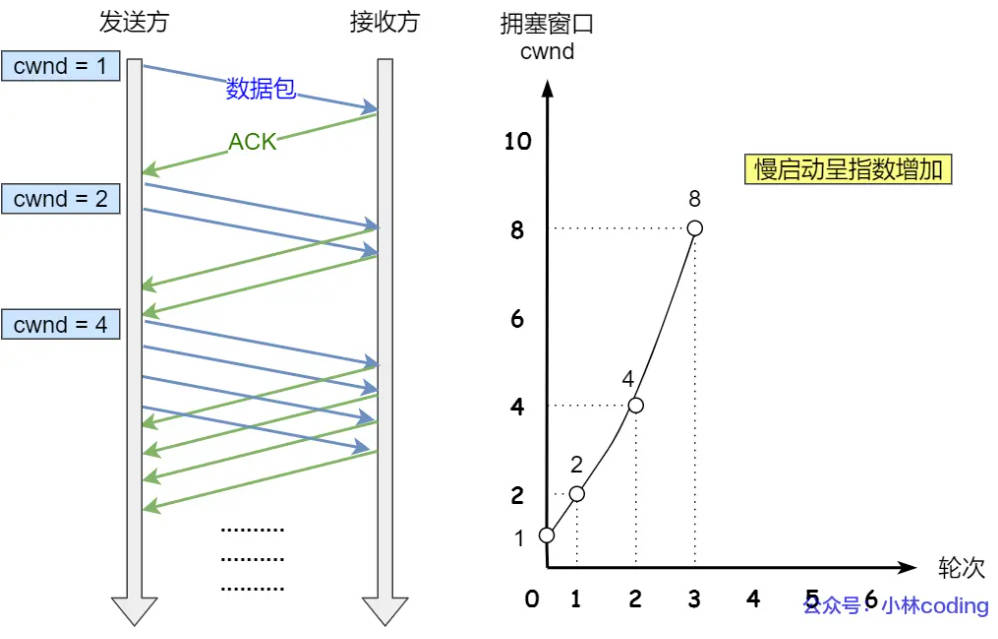
2. 拥塞避免
每当收到一个 ACK 时，cwnd 增加 `1/cwnd`。由指数增长变为线性增长。随着发包增加，网络慢慢进入拥塞状态，出现丢包。此时进入**拥塞发生算法**
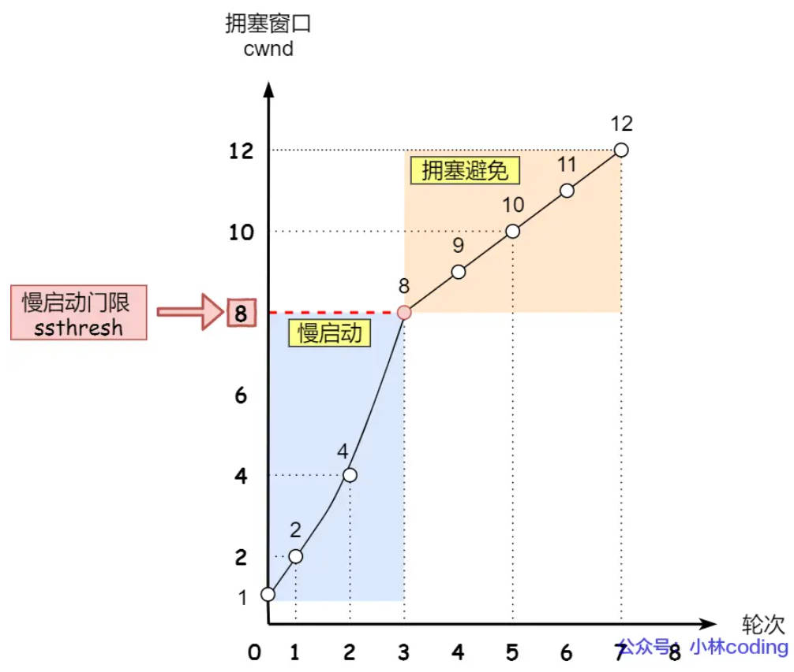
3. 拥塞发生
这个阶段的重传机制分为两种：
- 超时重传
使用拥塞发生算法
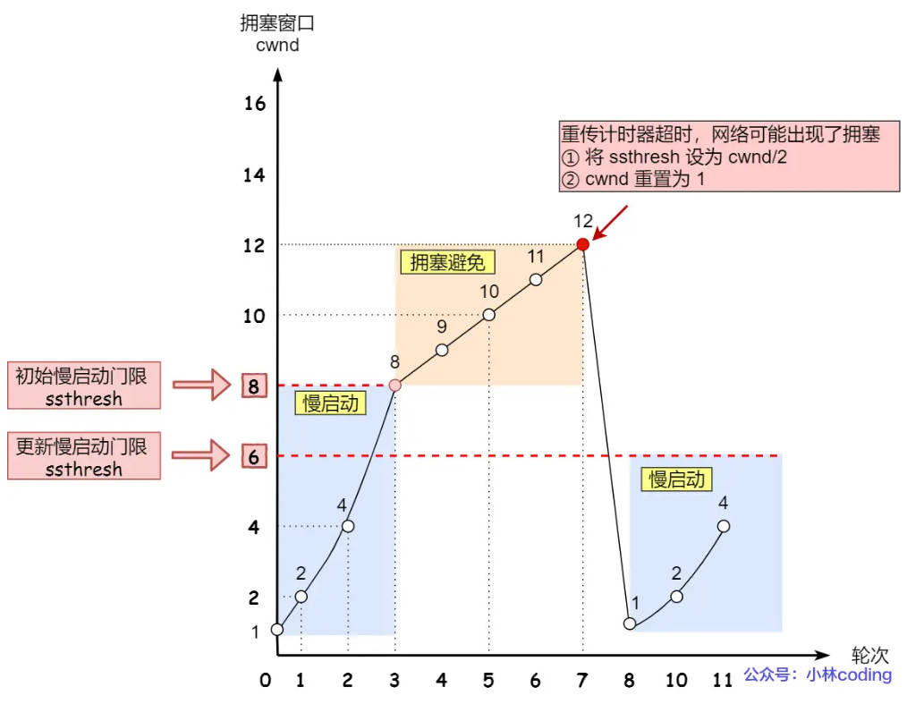
  - 慢启动门限变为cwnd的一半
  - cwnd重置为1
  - 重新开始慢启动
- 快速重传
当接收方发现丢了一个中间包的时候，发送三次前一个包的 ACK，于是发送端就会快速地重传，不必等待超时再重传
  - cwnd = cwnd/2 ，也就是设置为原来的一半;
  - ssthresh = cwnd;
  - 进入快速恢复算法
4. 快速恢复
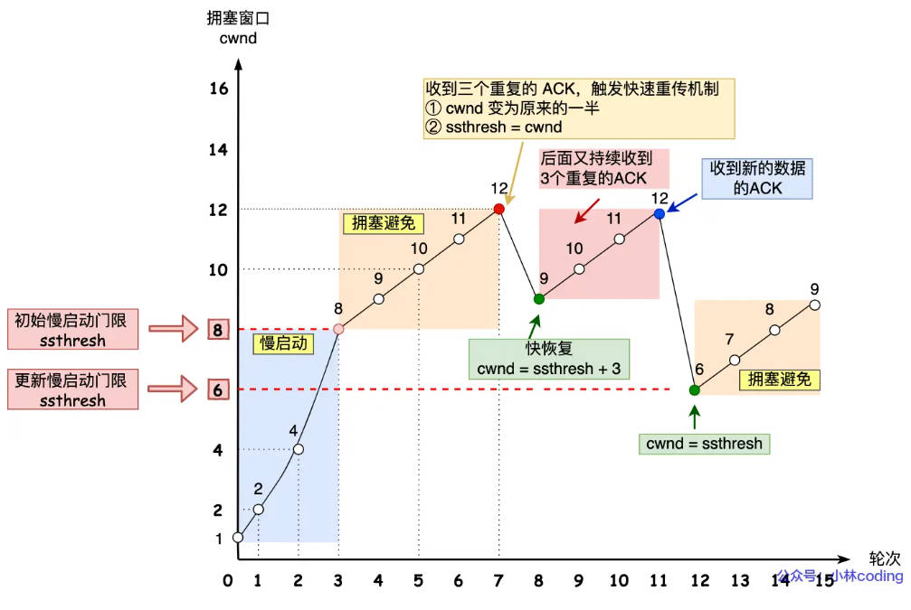
- 拥塞窗口 cwnd = ssthresh + 3 （ 3 的意思是确认有 3 个数据包被收到了）；
- 重传丢失的数据包；
- 如果再收到重复的 ACK，那么 cwnd 增加 1；
- 如果收到新数据的 ACK 后，把 cwnd 设置为第一步中的 ssthresh 的值，原因是该 ACK 确认了新的数据，说明从 duplicated ACK 时的数据都已收到，该恢复过程已经结束，可以回到恢复之前的状态了，也即再次进入拥塞避免状态；

### 描述一下打开百度首页的过程
- 解析URL：分析 URL 所需要使用的传输协议和请求的资源路径。如果输入的 URL 中的协议或者主机名不合法，将会把地址栏中输入的内容传递给搜索引擎。如果没有问题，浏览器会检查 URL 中是否出现了非法字符，则对非法字符进行转义后在进行下一过程。
- 缓存判断：浏览器缓存 → 系统缓存（hosts 文件） → 路由器缓存 → ISP 的 DNS 缓存，如果其中某个缓存存在，直接返回服务器的IP地址。
- DNS解析：如果缓存未命中，浏览器向本地 DNS 服务器发起请求，最终可能通过根域名服务器、顶级域名服务器（.com）、权威域名服务器逐级查询，直到获取目标域名的 IP 地址。
- 获取MAC地址：当浏览器得到 IP 地址后，数据传输还需要知道目的主机 MAC 地址，因为应用层下发数据给传输层，TCP 协议会指定源端口号和目的端口号，然后下发给网络层。网络层会将本机地址作为源地址，获取的 IP 地址作为目的地址。然后将下发给数据链路层，数据链路层的发送需要加入通信双方的 MAC 地址，本机的 MAC 地址作为源 MAC 地址，目的 MAC 地址需要分情况处理。通过将 IP 地址与本机的子网掩码相结合，可以判断是否与请求主机在同一个子网里，如果在同一个子网里，可以使用 ARP 协议获取到目的主机的 MAC 地址，如果不在一个子网里，那么请求应该转发给网关，由它代为转发，此时同样可以通过 ARP 协议来获取网关的 MAC 地址，此时目的主机的 MAC 地址应该为网关的地址。
- 建立TCP连接：主机将使用目标 IP地址和目标MAC地址发送一个TCP SYN包，请求建立一个TCP连接，然后交给路由器转发，等路由器转到目标服务器后，服务器回复一个SYN-ACK包，确认连接请求。然后，主机发送一个ACK包，确认已收到服务器的确认，然后 TCP 连接建立完成。
- HTTPS 的 TLS 四次握手：如果使用的是 HTTPS 协议，在通信前还存在 TLS 的四次握手。
- 发送HTTP请求：连接建立后，浏览器会向服务器发送HTTP请求。请求中包含了用户需要获取的资源的信息，例如网页的URL、请求方法（GET、POST等）等。
- 服务器处理请求并返回响应：服务器收到请求后，会根据请求的内容进行相应的处理。例如，如果是请求网页，服务器会读取相应的网页文件，并生成HTTP响应

### 网页非常慢，如何排查？
1. 先确定是服务端的问题，还是客户端的问题。先确认浏览器是否可以访问其他网站，如果不可以，说明客户端网络自身的问题，然后检查客户端网络配置（连接wifi正不正常，有没有插网线）；如果可以正常其他网页，说明客户端网络是可以正常上网的。
2. 如果客户端网络没问题，就抓包确认 DNS 是否解析出了 IP 地址，如果没有解析出来，说明域名写错了，如果解析出了 IP 地址，抓包确认有没有和服务端建立三次握手，如果能成功建立三次握手，并且发出了 HTTP 请求，但是就是没有显示页面，可以查看服务端返回的响应码：
- 如果是404错误码，检查输入的url是否正确；
- 如果是500，说明服务器此时有问题；
- 如果是200，F12看看前端代码有问题导致浏览器没有渲染出页面。
3. 如果客户端网络是正常的，但是访问速度很慢，导致很久才显示出来。这时候要看客户端的网口流量是否太大的了，导致tcp发生丢包之类的问题。

### 如何判断两个服务器正常连接？
可以运用 TCP 保活机制。这个机制的原理是这样的：定义一个时间段，在这个时间段内，如果没有任何连接相关的活动，TCP 保活机制会开始作用，每隔一个时间间隔，发送一个探测报文，该探测报文包含的数据非常少，如果连续几个探测报文都没有得到响应，则认为当前的 TCP 连接已经死亡，系统内核将错误信息通知给上层应用程序。

### 服务端正常启动，客户端请求不到，可能是什么造成的？怎么排查？
1. 客户端请求接口无响应
    - 检查接口**IP地址**是否正确，ping一下接口地址。
    - 检查被测**接口端口号**是否正确，可以在本机Telnet接口的IP和端口号，检查端口号能否连通
    - 检查服务器的**防火墙**是否关闭，如果是以为安全或者权限问题不能关闭，需要找运维进行策略配置，开放对应的IP和端口。
    - 检查你的客户端（浏览器、测试工具 (opens new window)），是否设置了**网络代理**，网络代理可以造成请求失败。
2. 客户端请求返回错误状态码
    - 400：客户端请求错误，比如请求参数格式错误
    - 401：未授权，比如请求header里，缺乏必要的信息头。（token，auth等）
    - 403：禁止，常见原因是因为用户的账号没有对应的URL权限，还有就是项目中所用的中间件，不允许远程连接（Tomcat）
    - 404：资源未找到，导致这种情况的原因很多，比如URL地址不正确
    - 500：服务器内部错误，出现这种情况，说明服务器内部报错了 ，需要登录服务器，检查错误日志，根具体的提示信息在进行排查
    - 502/503/504（错误的网关、服务器无法获得、网关超时）：如果单次调用接口就报该错误，说明后端服务器配置有问题或者服务不可用，挂掉了；如果是并发压测时出现的，说明后端压力太大，出现异常，此问题一般是后端出现了响应时间过长或者是无响应造成的

### 用户态和内核态的区别是什么？
- 内核态（Kernel Mode）：在内核态下，CPU可以执行所有的指令和访问所有的硬件资源。这种模式下的操作具有更高的权限，主要用于操作系统内核的运行。
- 用户态（User Mode）：在用户态下，CPU只能执行部分指令集，无法直接访问硬件资源。这种模式下的操作权限较低，主要用于运行用户程序

### 介绍一下`GRPC`协议

GRPC能够让应用像调用本地函数一样，去调用一台远程服务器上的函数

GRPC基于`HTTP/2`传输协议，将数据序列化为`Protobuf`格式进行传输。工作流程如下所示：


### 指针和引用有什么区别？
核心差异：
- 指针是一个**变量**， 储存的是内存地址，本身占据独立内存空间
- 引用是一个**变量的别名**， 初始化时绑定到目标，不占用独立内存

| 维度 | 指针 | 引用 |
| :-- | :-- | :-- |
| 初始化 | 可以声明为nullptr | 必须初始化 |
| 重新绑定 | 可以 | **绑定后不能修改** |
| 取地址 | 得到指针变量自身地址 | 得到被引用对象地址 |
| `sizeof` | 指针本身大小(64位系统8个字节) | 被引用对象大小 |
| 多级 | 支持`int ** p` | 语法上会折叠 |

### 一个声明了short、int、char的class，对其使用sizeof的结果是多少？
**考察内存对齐**
内存对齐原则：
1. 每个成员必须对齐到其自身大小的整数倍地址，比如：
   - short（2字节）→ 地址必须是2的倍数
   - int（4字节）→ 地址必须是4的倍数
   - double（8字节）→ 地址必须是8的倍数
   - char(1字节) 同理
2. 整个struct/class的大小必须是其最大成员对齐要求的整数倍
3. 成员声明顺序影响最终大小

因此答案是12

## 部分真题
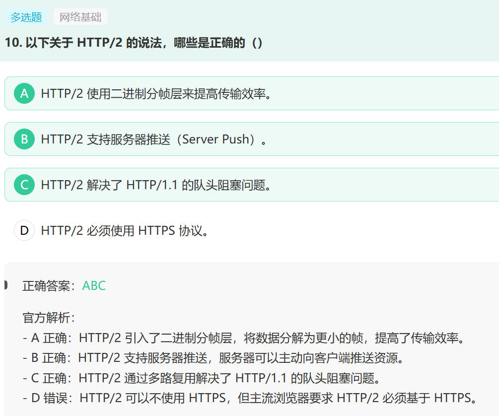

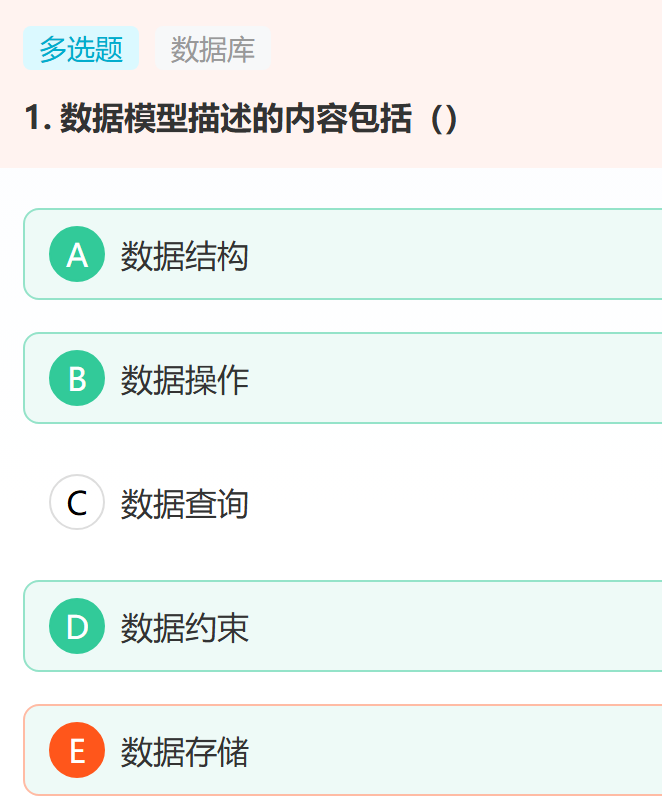
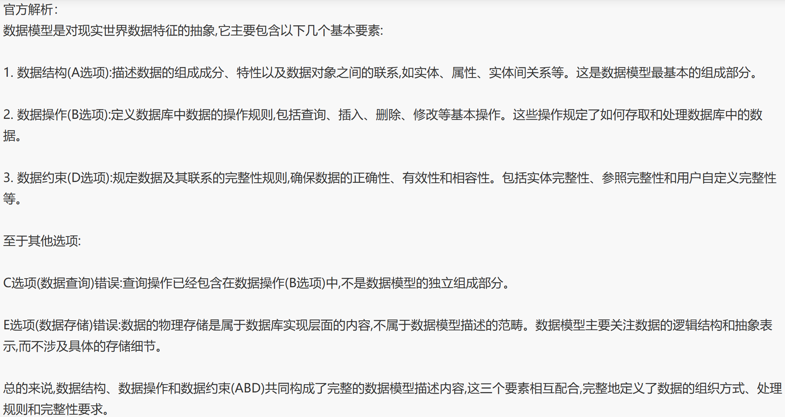

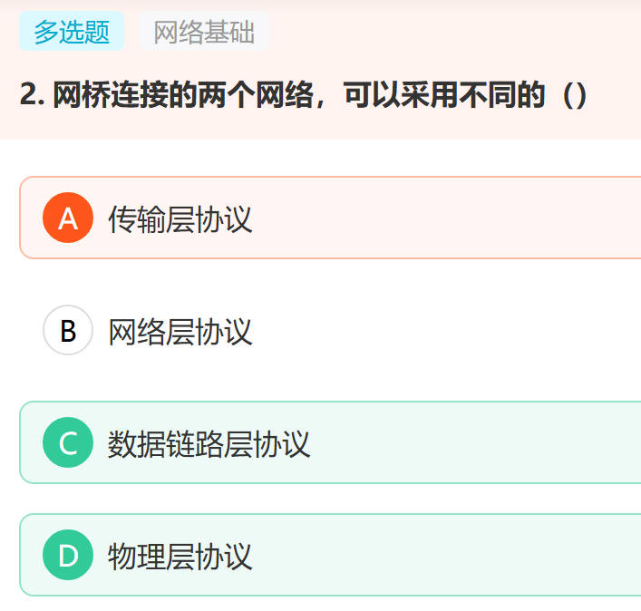
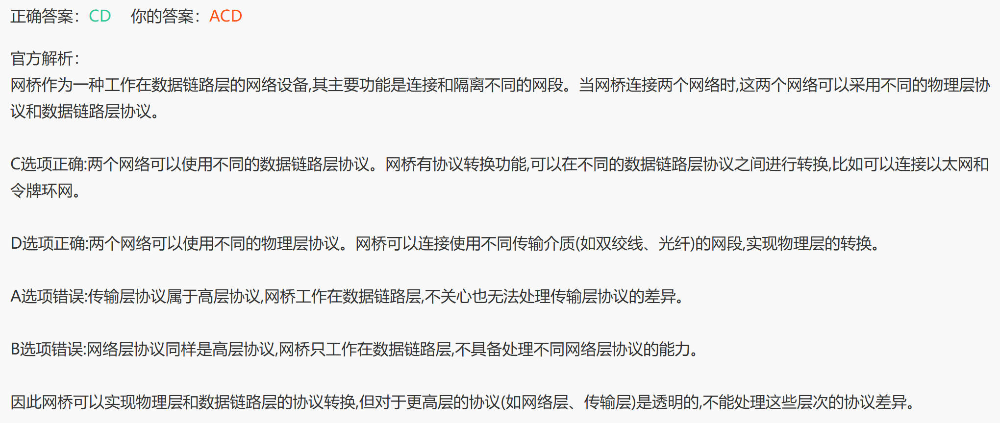

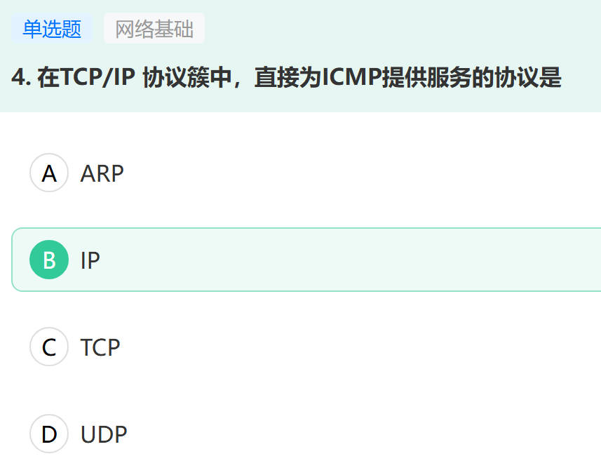
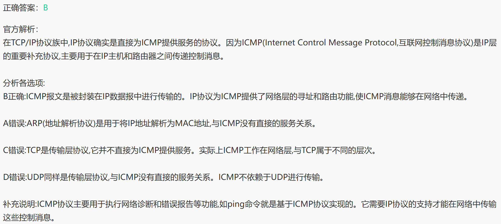

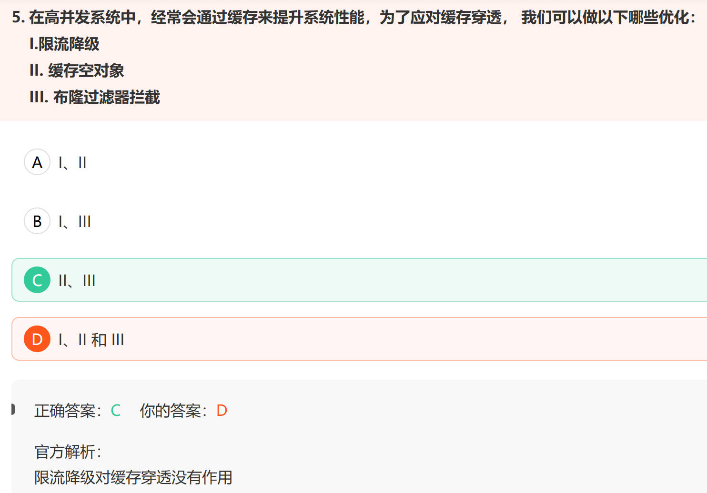

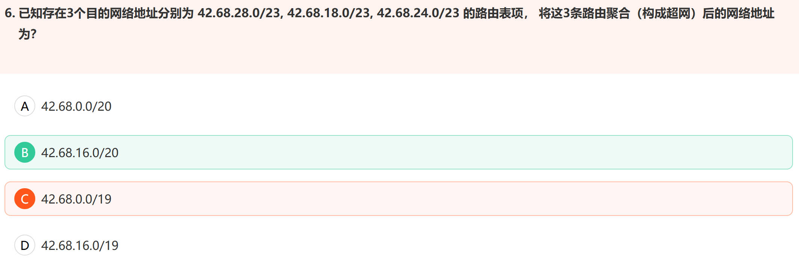

将IP地址转换为二进制之后寻找共同前缀：

`42.68.28.0` → 28 = `00011100`

`42.68.18.0` → 18 = `00010010`

`42.68.24.0` → 24 = `00011000`

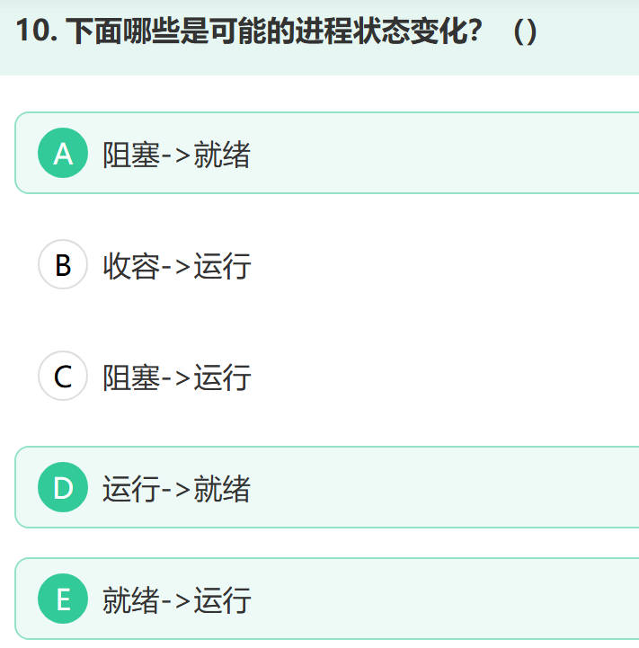

### 时间片是按照进程分配的吗？
在Linux中：
- 默认情况下，时间片按照线程分配(Linux内核调度器调度的是线程，而非进程)
- 特殊情况下，可以设置进程组调度实现按进程分配时间片的效果

### 移动语义是什么？它的实现原理是怎样的？如果类的移动构造delete掉会怎样？
**移动语义：** 允许资源所有权从一个对象转移到另一个对象，而无需进行深拷贝
```cpp
// 传统拷贝：深拷贝（昂贵）
string s1 = "Hello World";  // 分配内存
string s2 = s1;             // 复制整个字符串（分配新内存）

// 移动语义：浅拷贝 + 转移所有权（廉价）
string s3 = std::move(s1);  // s1 的资源转移到 s3，s1 变为空
// 只是指针赋值，没有分配新内存！
```

移动语义的核心：**右值引用`&&`**
```cpp
// 左值：有名字、可取地址
int x = 10;          // x 是左值
string s = "hello";  // s 是左值

// 右值：临时对象、没有名字
int y = 10 + 20;     // 10+20 是右值（临时结果）
string s2 = s + "!"; // s+"!" 是右值（临时对象）

// 右值引用：绑定到右值
int&& rref = 10;                    // 绑定到临时 int
string&& sref = string("temp");     // 绑定到临时 string
```

***示例***
```cpp
class MyString {
private:
    char* data;
    size_t size;
    
public:
    // 普通构造函数
    MyString(const char* str) {
        size = strlen(str);
        data = new char[size + 1];
        strcpy(data, str);
        cout << "构造: " << data << endl;
    }
    
    // 拷贝构造函数（深拷贝）
    MyString(const MyString& other) {
        size = other.size;
        data = new char[size + 1];
        strcpy(data, other.data);
        cout << "拷贝构造: " << data << endl;
    }
    
    // 移动构造函数（浅拷贝 + 窃取资源）⭐
    MyString(MyString&& other) noexcept 
        : data(other.data), size(other.size) {
        other.data = nullptr;   // 源对象放弃所有权
        other.size = 0;
        cout << "移动构造: 资源已转移" << endl;
    }
    
    // 析构函数
    ~MyString() {
        if (data) {
            delete[] data;
            cout << "析构: 释放资源" << endl;
        }
    }
};
```

**如果移动构造被delete**
1. 显式delete移动构造
    ```cpp
    class MyClass {
    public:
        MyClass() {}
        
        // 拷贝构造
        MyClass(const MyClass& other) {
            cout << "拷贝构造" << endl;
        }
        
        // 移动构造被删除
        MyClass(MyClass&&) = delete;
    };

    int main() {
        MyClass a;
        MyClass b = a;           // ✅ 拷贝构造（可用）
        
        MyClass c = std::move(a); // ❌ 错误！移动构造被 delete
        // error: use of deleted function 'MyClass::MyClass(MyClass&&)'
        
        // 只能使用拷贝构造
        MyClass d = a;           // ✅ 使用拷贝构造
        
        return 0;
    }
    ```
2. 只有拷贝构造、没有移动构造
    ```cpp
    class MyClass {
    public:
        MyClass() {}
        
        // 只有拷贝构造
        MyClass(const MyClass& other) {
            cout << "拷贝构造" << endl;
        }
        // 编译器不会自动生成移动构造
    };

    int main() {
        MyClass a;
        MyClass b = std::move(a);  // ✅ 调用拷贝构造（回退）
        // 即使有 std::move，因为没有移动构造，使用拷贝构造
        cout << "使用拷贝构造作为后备" << endl;
        
        return 0;
    }
    ```

### `io_context`在单线程和多线程中分别是怎么工作的？
*先介绍一下io_context*
传统多线程基于**事件驱动**，为每个请求或任务创建一个新线程。线程是操作系统调度最小单位，创建、切换、销毁都需要内核参与，开销很大；
`io_context`基于事件驱动，使用少量线程(一般等于CPU核心数)监听大量I/O时间，当事件发生时，线程才处理对应回调函数。它可被视作I/O 事件管理 + Handler 调度。Handler是一个可调用对象，是当某个I/O事件发生时将会执行的代码
```txt
传统多线程：像一家餐厅，来一桌客人就雇一个专职服务员（线程）。客人多了，服务员（线程）数量爆炸，管理混乱，成本极高。
io_context：像一家餐厅，只雇了 4 个训练有素的服务员（线程池）。他们不专门服务某一桌，而是站在大堂（io_context 事件循环）里，看到哪桌客人举手（I/O 就绪）就立刻去服务，服务完再回来继续等待。

传统多线程：编程模型简单直观，代码是同步阻塞的。例如 read(fd, buf, size) 会阻塞当前线程直到数据读完。
io_context：编程模型是异步非阻塞的。你发起一个 async_read，然后立即返回，当数据准备好时，io_context 会调用你提供的回调函数
```
- 单线程:只有一个线程调用`io_context::run()`，负责所有异步事件的监听和回调。代码简单逻辑清晰
- 多线程:线程池中的多个线程同时调用一个`io_context`对象的`run()`方法，共同承担时间循环任务

在当前项目中，不同模块使用的`io_context`池初始化数量不一样。面向注册的GateServer还是VarifyServer，由于处理线程少，只将池中io_context初始化为2；ChatServer采用thread中的库，调取CPU线程数相当的初始化数量

### 介绍一下QT信号槽机制
信号槽是QT实现的一种对象间通信机制，发送者(信号)和接受者(槽)解耦，支持一对多、多对一。底层通过元对象系统动态查找并调用槽函数。相比传统回调，信号槽牺牲了部分性能换区更清晰的架构和更低的耦合度

信号发射时，会按连接顺序触发所有活跃且未阻塞的槽，触发方式分同步和异步两种。跨线程时不立即执行所有槽函数，只把调用请求入队

### 每个类有几张虚函数表？一个类的所有实例化对象共用一张虚函数表吗？子类和父类呢？
1. 每个类有几张虚函数表
    单继承：每个类只有一张虚函数表
    ```cpp
    class Base {
        virtual void func1() {}
        virtual void func2() {}
    };

    class Derive : public Base {
        virtual void func1() override {}  // 重写
        virtual void func3() {}           // 新增
    };
    ```
    ```text
    Base 类：     1 张虚函数表（包含 func1, func2）
    Derive 类：   1 张虚函数表（包含 Derive::func1, Base::func2, func3）
    ```

    多重继承：每个类的虚函数表取决于直接基类数量
    ```cpp
    class Derive : public Base1, public Base2, public Base3 {
        // ...
    };
    ```
    ```text
    Derive 类：   3 张虚函数表
              ├── 表1（对应 Base1）
              ├── 表2（对应 Base2）
              └── 表3（对应 Base3）
    ```
2. 一个类所有实例化对象是否共用一张虚函数表
    是，每个对象只存储一个 vptr（虚函数表指针），指向共享的虚函数表，这样可以节省内存
3. 子类和父类
    子类和父类具有不同的虚函数表，涉及**覆盖、继承、新增**
    ```cpp
    class Base {
    public:
        virtual void func1() { cout << "Base::func1()" << endl; }
        virtual void func2() { cout << "Base::func2()" << endl; }
    };

    class Derive : public Base {
    public:
        virtual void func1() override { cout << "Derive::func1()" << endl; }
        virtual void func3() { cout << "Derive::func3()" << endl; }
    };

    int main() {
        Base b;
        Derive d;
        
        Base *p1 = &b;
        Base *p2 = &d;
        
        p1->func1();  // Base::func1()
        p2->func1();  // Derive::func1()  ← 多态！
    }
    ```
    ```text
    Base 类的虚函数表（vtable for Base）：
    ┌─────────────────────┐
    │ [0]: Base::func1()  │
    │ [1]: Base::func2()  │
    └─────────────────────┘

    Derive 类的虚函数表（vtable for Derive）：
    ┌─────────────────────┐
    │ [0]: Derive::func1()│  ← 覆盖了 Base::func1()
    │ [1]: Base::func2()  │  ← 继承未重写的函数
    │ [2]: Derive::func3()│  ← 新增函数
    └─────────────────────┘
    ```

### 为什么选择C++？
- C++允许手动管理内存生命周期，在高性能服务器、游戏引擎和底层基础设施方面是刚需。比如使用`shared_ptr`和`unique_ptr`在编辑器确定资源释放时期
- C++的类、模板、lamda表达式在编译器展开，运行时不存在多余性能消耗

### 你知道哪些设计模式？介绍一下单例模式
- 单例模式
    保证一个类在整个程序中只有一个实例，并提供统一的访问入口.
    聊天服务器项目中，`RedisMgr、MySQLMgr` 这种全局资源管理类就比较适合使用单例模式

- 工厂模式
    工厂模式主要用于封装对象的创建过程,调用方不需要知道具体的派生类应该如何创建，只需要告诉工厂需要什么类型即可
    1. 简单工厂
        由一个工厂类根据传入参数，动态决定应该创建哪个产品类的实例
    2. 工厂方法
        定义一个用于创建对象的接口，让子类决定实例化哪个类。工厂方法使一个类的实例化延迟到其子类
    3. 抽象工厂
        提供一个接口用于创建相关或依赖对象的家族，而不明确指定具体类

```cpp
class Character {
protected:
    std::string name;
    int health;
    int attack;
    int magic;
public:
    Character(const std::string& n, int h, int a, int m) 
        : name(n), health(h), attack(a), magic(m) {}

    virtual ~Character() = default;

    virtual void showInfo() const {
        std::cout << "name:" << name << std::endl;
        // 下略
    }

    virtual void specialSkill() = 0;

    std:: string getName() const {return name;}
};

// 具体角色：战士(Warrior)，法师(Mage)，射手(Archer)等
class Warrior : public Character {
public :
    Warror(const std::string& name) : Character(n:name, h:150, a:80, m:20) {};

    void specialSkill() override {
        std::cout << name << "使用【旋风斩】" << std::endl;
    }

    void showInfo() const override {
        std::cout << "【战士】" << "name:" << name << std::endl;
        // 下略
    }
}

class Mage : public Character {}

class Archer : public Character {}

// 简单工厂
// 1. 枚举每个角色
enum class CharcaterType{
    WARRIOR, 
    MAGE, 
    ARCHER,
};

// 2. 根据参数type传递角色名，使用switch语句枚举type
class SimpleCharacterFactory {
public:
    static std::unique_ptr<Character>
    CreateCharacter(CharacterType type, const std::string &name) {
        switch(type) {
            case CharacterType::WARRIOR:
                return std::make_unique<Warrior>(name);
            case CharacterTYpe::MAGE:
                return std::make_unique<Mage>(name);
            case CharacterTYpe::ARCHER:
                return std::make_unique<Archer>(name);    
            default:

        }
    }
};

/**
* 简单工厂在扩充内容（比如增加角色时）比较麻烦
* 工厂方法为角色生成一个抽象工厂类，依此实现实例化延迟到子类的效果
*/

// 工厂方法
class CharacterFactory {
public:
    virtual ~CharacterFactory() = default;
    // 不提供默认创建，将createCharacter抽象为纯虚函数->CharacterFactory无法实例化
    virtual std::unique_ptr<Character> createCharacter(const std::string &name) = 0;
    // 使用setupCharaceter创建角色
    std::unique_ptr<Character> CreateCharacterWithSetup(const std::string &name) {
        auto character = createCharacter(name);
        setupCharaceter(character.get());
        return character;
    }
protected:
    virtual void setupCharaceter(Character* character) {
        std::cout<< "角色" << character -> getName() << "创建完成，进行基础设置..." << std::endl;
    }
};

class WarriorFactory : public CharacterFactory {
public:
    virtual std::unique_ptr<Character> createCharacter(const std::string &name) {
        return std::make_unique<Warrior>(name);
    } 
protected:
    virtual void setupCharaceter(Character* character) {
        // 保留基类构造
        CharacterFactory::setupCharaceter(character);
        std::cout << "为战士配备腐化黑拥..." << std::endl;
    }
};

// 法师等，略

/**
* 工厂方法先抽象基类，规范初始化方法(CreateCharacterWithSetup)，将初始化流程和角色创建流程交给子类去实现
* 其中，子类属性各不相同的初始化抽象为纯虚函数(createCharacter);子类存在公共部分的则写进基类中(CharacterFactory::setupCharaceter)
* 这样一来，如果需要添加爱其他子类，或单独子类需要扩充属性，不会对基类或其他子类产生影响
* 简单工厂和工厂方法都是创建一个产品，而抽象工厂创造的是一个产品族 
```

### 线程池如何处理`thread_local`?
1. 为什么需要线程池
   复用已创建的线程资源，避免频繁进行线程的创建与销毁所带来的系统开销
   核心参数：
   核心线程数
   最大线程数
   非核心线程空闲存活时间
   任务阻塞队列：用于缓存待处理的任务
2. 什么是`thead_local`
   `thread_local` 是C++语言的一个存储类说明符，告诉编译器：“这个变量在每个线程中都有一个独立的实例。”
3. 线程池+`thread_local`
   - 每个线程第一次访问该变量时，会创建一份独立的副本。
   - 该副本的生命周期与线程绑定：线程销毁时，变量自动析构。
   - 语法简洁，直接像全局变量一样使用，无需像Java那样通过 set/get 方法操作
   - 编译器保证RAII，不会内存泄漏

```cpp
#include <iostream>
#include <thread>

thread_local int g_value = 0;  // 每个线程都有自己的 g_value 副本

void foo() {
    g_value++;  // 当前线程的副本 +1
    std::cout << std::this_thread::get_id() << ": " << g_value << std::endl;
}

int main() {
    std::thread t1(foo);
    std::thread t2(foo);
    t1.join();
    t2.join();
    // 输出：线程1打印1，线程2也打印1（各自独立）
    return 0;
}
```

### 介绍一下`static`和`const`的区别
`const` 声明某个值的不可修改性
- 定义常量
- 修饰函数传参
  ```cpp
  void func(const string& str);
  // 防止函数内修改该变量
  ```
- 修饰函数返回值
  ```cpp
  const string GetString();
  // 防止返回值被修改(如 GetString() = "Mark";)
  ```
- 修饰指针
  1. 常量指针(const T*), 不能通过指针修改该值，但是可以改变指针指向(底层const，指针指向常量)
  2. 指针常量(T* const), 可以通过指针修改该值，但是不能修改指针指向(顶层const，指针自身为常量)
   **this指针本身为一个指针常量，不能修改其指向**
   **引用可以视为一个指针常量，声明时需要初始化，之后无法修改引用对象**
- 修饰引用
  ```cpp
  int v3 = 90;
  const int& rv3 = v3;
  rv3 = 89;     // error
  ```
  无法通过引用修改该值 
- 修饰成员函数
  不能修改类对象成员变量，相当于修饰了成员函数中的隐藏的this指针
  ```cpp
  class AnyClass {
    private:
        int val;
    public:
        int GetVal() const {
            // ... 不能修改val
            return val;
        }
  };
  ```
  **对象本身并不存储this指针**，调用函数时将对象地址作为实参传递给this指针(相当于GetVal(this) {})，由寄存器进行传递

`static`关键字用于修饰变量和函数
- 静态成员变量
  1. 属于类，与所有类对象共享，存储在全局数据区
  2. 需要在类外定义才能分配存储空间，定义时可以忽略`protected`/`private`
  3. 访问权限由类的public/protected/private决定
- 静态成员函数
  1. 不能直接访问非静态类成员函数和非静态类成员变量
  2. 无需创建实例，可以通过类名调用(**静态函数没有this指针**)
  3. 访问权限由类的public/protected/private决定
```cpp
#include <iostream>

class Student {
public:
    // 静态成员变量（类级别，所有对象共享）
    static int totalStudents;
    
    // 非静态成员变量（对象级别，每个对象独有）
    std::string name;
    int age;
    
    // 静态成员函数
    static void showTotal() {
        // 特性1：✅ 能访问静态成员
        std::cout << "总学生数: " << totalStudents << std::endl;
        
        // 特性1：❌ 不能访问非静态成员
        // std::cout << "姓名: " << name << std::endl;    // 编译错误！
        // std::cout << "年龄: " << age << std::endl;     // 编译错误！
        // printInfo();                                   // 编译错误！不能调用非静态函数
    }
    
    // 非静态成员函数
    void printInfo() {
        std::cout << "姓名: " << name << ", 年龄: " << age << std::endl;
    }
    
    // 构造函数
    Student(const std::string& n, int a) : name(n), age(a) {
        totalStudents++;  // 每创建一个学生，总数+1
    }
};

// 静态成员变量必须在类外初始化
int Student::totalStudents = 0;

int main() {
    // 特性2：无需创建实例，通过类名调用静态函数
    Student::showTotal();  // 输出: 总学生数: 0
    
    // 创建两个对象
    Student s1("小明", 18);
    Student s2("小红", 19);
    
    // 再次通过类名调用静态函数
    Student::showTotal();  // 输出: 总学生数: 2
    
    // ❌ 不能通过类名调用非静态函数
    // Student::printInfo();  // 编译错误！
    
    // 非静态函数必须通过对象调用
    s1.printInfo();  // 输出: 姓名: 小明, 年龄: 18
    s2.printInfo();  // 输出: 姓名: 小红, 年龄: 19
    
    return 0;
}
```
| 对比 | 静态成员变量 | 非静态成员函数 |
| :-- | :-- | :-- |
| 归属 | 类本身 | 对象 |
| 调用方式 | 类名::函数名() | 对象.函数名() |
| this指针 | 无 | 有 | 
| 访问静态成员 | 能 | 能 |
| 访问非静态成员 | 不能 | 能 |
| 内存中 | 只有一份 | 逻辑上*每个对象一份 |

*在代码区非静态成员函数只有一份机械码，但是内存的堆栈内存放对象数据，当对象调用函数时，编译器传入this指针，指向当前对象(每个对象调用函数操作的是自己的数据)

### 虚拟内存是什么，操作系统是如何实现分配的？
虚拟内存是一种内存管理技术，它让负担过重的操作系统 (OS) 能够创建一种合成的内存形式，从而超越自身的内存限制运行
每个进程“看到”的地址范围相同，但是内容完全隔离；进程不知道物理内存的存在，认为自己独占所有资源
1. 内核如何提供虚拟内存？
   操作系统维护每个进程独立的页表，页表中记录了虚拟内存到物理页框的映射关系。虚拟内存分配分为如下两个阶段
   1. 预留虚拟地址
      - 应用程序调用 `malloc()` 或 `new` 申请内存时，操作系统只在虚拟地址空间中划出一块区域，标记为“已预留”。此时**没有分配物理内存**，只是修改了进程的虚拟内存区域的数据结构，记录这段地址的权限（读/写/执行）和映射方式（文件映射/匿名映射）
   2. 按需分配
      - 当程序真正读写这块虚拟地址时，CPU触发缺页中断，陷入内核
      - 操作系统检查：
        - 地址非法(访问未预留的区域)，触发`SIGSEGV`错误
        - 地址合法单尚未映射物理页->从空闲物理页框列表中取出一页，在页表中建立虚拟页，使其成为物理页框的映射
        - 如果该页之前被换出到磁盘，从磁盘读回物理内存
2. 物理页框和虚拟页表
   虚拟内存基本单元：
   - 虚拟页（VP，Virtual Page）：虚拟地址空间被划分为固定大小的块（通常4KB）。
   - 物理页框（PP，Page Frame）：物理内存被划分为同样大小的块（也是4KB）。
   - 页表（Page Table）：存储VP到PP的映射关系，是每个进程独立的数据结构。页表不同->映射不同->内存隔离

```text
每个进程看到的虚拟地址空间（0 ~ 2^N）
              ↓
        [MMU + TLB]（硬件加速翻译）
              ↓
         查页表（内存中的数据结构，每进程独立）
              ↓
   ┌──────────┼──────────┐
   ↓          ↓          ↓
未分配    Valid=1     Valid=0
(无物理页) (在物理内存) (在磁盘)
              ↓          ↓
         物理页框    Swap分区/文件
         (真正运行)
```

3. 进程中的线程
   - 进程隔离：进程A的页表中，虚拟地址0x1000指向物理页框#5；进程B的页表中，同一个虚拟地址0x1000指向物理页框#20。页表不同 → 映射不同 → 内存隔离。
   - 线程共享：同一进程内的所有线程，共享同一个页表。因此，线程A和线程B访问虚拟地址0x1000时，MMU查的是同一张页表，映射到同一个物理页框#5。页表相同 → 看到同一块物理内存 → 自然共享。
   - 线程的栈如何独立：线程栈是由操作系统内核直接分配的虚拟内存区域。主线程创建时，先得到进程的栈区作为自己的栈，后续子线程则在内存映射段进行分配


### 进程间通信会用到什么技术？
1. 管道
2. 信号
3. 消息队列
   - 进程通过系统调用向消息队列发送/接收结构化的消息块
   - 数据有边界，支持多对多通信，消息持久（队列独立于进程存在）
4. 共享内存
   - 多个进程将同一块物理内存区域映射到各自的虚拟地址空间，直接读写(速度快、危险)
   - 需要配合信号量（Semaphore）或互斥锁（Mutex） 实现同步，以避免数据竞争
5. 信号量
6. 套接字(Socket)
   - 支持同一台机器（Unix Domain Socket）和不同机器（TCP/IP Socket），信息通过字节流或数据报(SOCK_DGRAM)传递
   - 最通用，支持网络通信
   - 一般用于Web服务器与客户端、微服务RPC、本地进程间RPC(如Redis的Unix Socket连接)等
7. 内存映射文件
   - 共享内存的变体
   - 将文件映射到进程的虚拟地址空间，多个进程映射同一文件实现共享

### WebSocket和HTTP有什么区别？
1. 五层网络模型
   | 层级 | 协议 |
   | :-- | :-- |
   | 应用层 | HTTP、WebSocket、FTP、SMTP |
   | 传输层 | TCP/UDP |
   | 网络层 | IP |
   | 链路层 | Ethernet |
   | 物理层 | (网线、光纤) |
   
   `WebSocket`和`HTTP`均位于应用层
2. 通信模型
   - HTTP为**半双工无状态**的请求-响应协议。客户端发起请求，服务端返回响应，每次请求独立，服务端不记忆客户端
   - WebSocket为**全双工持久连接**协议。客户端和服务端可以随时主动发送数据，一次握手建立持久连接，双方保持会话
3. 数据帧格式
   - HTTP/1.1 纯文本协议，头部是 ASCII 字符串，体可以是二进制（如图片），但头部开销大（通常几百字节）
   - HTTP/2 二进制分帧，支持头部压缩（HPACK），但依然是请求-响应模型
   - WebSocket 二进制帧协议，帧头仅 2~14 字节，开销极小。支持文本帧、二进制帧、ping/pong 心跳帧、关闭帧
4. 连接
   HTTP短连接
   WebSocket长连接，直到任意一方主动关闭
5. 性能
   - HTTP/1.1 实时聊天场景，每个消息都要带几百字节的头部 → 开销巨大。
   - WebSocket 每条消息只有 2~14 字节头部 → 适合高频小包通信

### HTTP和HTTPS有什么区别？
见上文

### 子类C继承父类A、B(class C : public A, public B),它在构造和析构时会如何效用构造函数和析构函数？
**调用构造函数**
1. 调用虚基类构造函数
2. 调用非基类构造函数，按照**继承声明顺序**(而不是初始化列表顺序)从左向右严格调用
3. 调用成员对象构造函数
4. 执行C自己的构造函数

**调用析构函数**
1. 执行C的析构函数体
2. 析构成员对象(逆序)
3. 析构基类，**按声明逆序**

**如果构造函数没有显式调用父类构造会怎么样**
编译器自动调用父类默认构造函数(无参构造)。如果父类只有有参构造函数，那么**必须**显示调用
**程序员显式声明了任何构造函数（包括带参的、拷贝的、移动的），编译器就不再自动生成默认构造函数**
`= delete` 的典型场景是：你想明确告诉编译器“我不希望这个函数被调用”，但编译器本来可能会隐式生成它
1. 禁止拷贝构造、拷贝赋值
    ```cpp
    class Singleton {
    public:
        Singleton(const Singleton&) = delete;
        Singleton& operator=(const Singleton&) = delete;
    };
    ```
2. 强调“没有默认构造”,即使不加`= delete`也一样，只用于可读性说明
    ```cpp
    class A {
    public:
        A(int x) { }
        A() = delete;   // 明确告诉读者：我不希望被默认构造
    };
    ```
3. 阻止隐式转换
    ```cpp
    void f(int x) { }
    void f(double) = delete;   // 禁止用double调用
    ```


```cpp
class A {
public:
    A(int x) { cout << "A(int)" << endl; }
};

class C : public A {
public:
    // 错误！A没有默认构造
    // C() { }  
    
    // 必须显式调用
    C() : A(10) { }  
};
```

**存在虚继承的情况**
形如：
```text
     A
    / \
   B   C
    \ /
     D
```
的结构，class D : public B, public C.B、C都继承自A
构造顺序变为：
1. 构造虚基类 A（只构造一次，由最派生类 D 负责）。
2. 再按声明顺序构造 B 和 C（但不再构造它们内部的 A 子对象）。
3. 最后构造 D

```text
构造 A
构造 B
构造 C
析构 C
析构 B
析构 A
```

**如果 C 的构造函数抛出异常，已经构造好的 A 和 B 会析构吗**
会。C++保证完全构造好的子对象（基类或成员）会在异常传播时自动析构（栈展开机制）。但 C 自身的析构函数不会被调用，因为 C 还没有构造完成

### 什么是临界区？
临界区是一段访问共享资源(如全局变量、文件、数据库连接)的代码，这段代码在同一时刻只允许一个线程执行，否则会导致数据不一致或程序崩溃
三要素：
共享资源：多个线程需要访问的数据（如全局变量、队列、文件）
竞争条件：多个线程同时进入临界区，导致数据错乱
互斥访问：同一时刻只有一个线程能进入临界区，其他线程等待

### 如何实现线程安全的单例模式?
```cpp
class Singleton {
public:
    static Singleton& getInstance() {
        static Singleton instance; // 魔法在这里
        return instance;
    }
    Singleton(const Singleton&) = delete;
    Singleton& operator=(const Singleton&) = delete;
private:
    Singleton() = default;
};
```
函数内的**静态局部变量的初始化是线程安全的**。编译器会在底层插入互斥机制，保证多个线程同时首次调用 getInstance() 时，只有一个线程执行构造，其余等待

### 线程池:生产者-消费者模式
- 构造：维护一个线程安全的队列实现连接复用
- 析构
  - 加锁
  - 调用Close()函数通知等待线程退出等待
  - 清空队列
- 取连接
  - 加锁
  - 连接池为空，阻塞等待
  - wait条件等待，连接池非空或者停止标志b_stop置位时唤醒
- 还连接
  - 加锁
  - 如果连接池已经关闭，直接丢弃
  - 没关的话讲连接放回连接池，唤醒一个线程
```text
时间线        线程A                          线程B
T1          获取锁成功                       等待锁（阻塞）
T2          检查队列：非空                   （等待）
T3          pop 取出 Conn1                   （等待）
T4          返回 Conn1，锁释放               获取锁成功
T5          拿着 Conn1 去发请求（不持有锁）   检查队列：非空
T6          发请求中...                      pop 取出 Conn2
T7          发请求中...                      返回 Conn2，锁释放
T8          发请求中...                      拿着 Conn2 去发请求
```

## 项目
### 项目中遇到的难处总结
1. Http在Cpp中基于TCP底层实现，不同于JAVA等，需要自己手动实现超时检测函数，在发送完数据后启动定时器检测超时。(HttpConnetion-ChekDeadline)
2. 解读条件变量+互斥锁的生产者消费者逻辑(`LogicSystem::DealMsg()`)中`wait`方法的应用
   ```cpp
   while (_msg_que.empty() && !_b_stop) {
        _consume.wait(unique_lk);
    }
   ```
   核心作用：让工作线程在“没有消息可处理”时，**安全地休眠，不浪费CPU**
   `_msg_que`（消息队列）是共享资源，会被多个线程同时访问：
    - 生产者线程（网络I/O线程）：收到消息后，往队列里 push。
    - 消费者线程（DealMsg 工作线程）：从队列里 pop 消息并处理
    **对比：**
   - 忙等：CPU占用100%，啥都没干
   - sleep：消息在睡眠期间到达需要等待
   - wait：线程真正挂起，消息到达立即唤醒，延迟低，不占CPU
  **wait逻辑**
  - 释放锁：把 `unique_lk` 持有的 `_mutex` 释放掉。这样生产者线程才能拿到锁，往队列里 push 消息。
  - 挂起线程：当前线程进入睡眠状态，不再占用CPU，等待被 `notify_one()` 或 `notify_all()` 唤醒。
  - 被唤醒后重新加锁：当生产者调用 `_consume.notify_one()` 时，工作线程被唤醒，重新尝试获取 `_mutex`。获取成功后，`wait` 返回，继续执行
  **注意，释放锁和挂起是原子操作，中间不会被其他线程插入。这保证了不会错过任何通知**
3. zanwu 

### 聊天信息持久化怎么做？

### 服务器掉线会怎样？

### 连接池关闭时，为什么要唤醒所有线程？
防止没被叫醒的线程会永远阻塞在wait上，导致程序无法退出。
补充，等待线程全部结束后再析构的原因：防止工作中的线程访问已析构的成员变量会导致未定义行为

### 下列代码会输出什么？
```cpp
#include <iostream>
using namespace std;

class A {
public:
    void func1() { cout << "A::func1" << endl; }
    virtual void func2() { cout << "A::func2" << endl; }
};

class B : public A {
public:
    void func1() { cout << "B::func1" << endl; }
    void func2() override { cout << "B::func2" << endl; }
};

int main() {
    A* p = new B();  // 基类指针指向派生类对象（这是常见场景）
    p->func1();
    p->func2();
    delete p;
    return 0;
}
```
| 函数 | 调用结果 | 说明 |
| :-- | :-- | :-- |
| `func1()` |	`A::func1` | 它是非虚函数，调用在**编译期**就确定了，编译器只看指针的**静态类型**（A*），所以直接调用 A 的版本。这叫静态绑定（早期绑定）。|
| `func2`() |	`B::func2` | 它是虚函数，调用在**运行期**决定。p 指向的实际对象是 B，通过对象的虚函数表（vtable） 找到 B::func2 的地址并调用。这叫动态绑定（晚期绑定）。|

因此输出应为:
```text
A::func1
B::func2
```
图解：
```text
        指针 p (静态类型 A*)
              ↓
    ┌─────────────────┐
    │  实际对象 (B)    │
    │  ┌─────────────┐ │
    │  │ vptr (虚指针)│ │────→ 指向 B 的虚函数表
    │  ├─────────────┤ │      ┌──────────────┐
    │  │  成员变量    │ │      │ &B::func2    │
    │  └─────────────┘ │      └──────────────┘
    └─────────────────┘
```

### `io_context`-`session`-`socket`辨析
| 对象 | 本质 | 管什么 |
| :-- | :-- | :-- |
| `io_context` | 异步事件调度器 | 谁来等待事件、执行回调 |
| `socket` | TCP 通信端点 | 谁和谁收发字节 |
| `session` | 应用层会话对象 | 一条连接的协议、用户、缓存、发送队列和生命周期 |

```text
io_context
└── 调度 socket 的异步读写、accept、定时器、信号回调
socket
└── 一条实际 TCP 连接的收发端点
CSession
└── 拥有一个 socket，并在其上实现协议解析、用户绑定和消息收发
```

1. `io_context`:异步事件循环与执行上下文
  负责：
  - 登记异步操作
  - 等待网络、定时器、信号等事件
  - 事件发生后执行回调
  - 作为socket、acceptor、timer等Asio对象的执行上下文
    ```text
    在`AsioIOServicePool`中，主`io_context`负责接受新连接、处理信号；
    I/O池中的`io_context`负责承载客户端连接的读写回调
    ```
2. `socket`:实际TCP通信端点
   作为操作系统TCP套接字的C++封装，`socket`只关心(异步读写)：
    ```text
    建立连接
    接收字节
    发送字节
    关闭连接
    ```
    而不对：
    ```text
    用户 uid；
    登录 token；
    好友关系；
    JSON 业务字段；
    消息队列；
    Redis 在线状态。
    ```
    作反应
    在`CSession`中：
    ```cpp
    tcp::socket _socket;
    std::string _session_id;
    char _data[MAX_LENGTH];
    CServer* _server;
    std::queue<shared_ptr<SendNode>> _send_que;
    int _user_uid;
    ```
    只有`_socket`是底层网络端点，其余均为上层连接附加状态
3. `CSession`: 一条连接的应用层会话,服务端用它管理客户端TCP长连接
     1. 创建：每个``session`创建时生成UUID，给予连接一个`session_id`
     2. 自定义协议拆包，方法略。`socket`收到字节流后由`CSession`将其还原为完整业务消息
     3. 网络层业务层解耦: 读取完整消息后，`CSession`将其投递给`LogicSystem`(如此一来，网络I/O线程不必再直接执行Redis、MySQL、gRPC等业务逻辑)
     4. 保存用户关联
        ```text
        CServer::sessions : session_id->CSession
        UserMgr : uid->CSession
        上述索引分别解决：
        按连接管理和清理：session_id->session
        按用户推送信息： uid->session
        ```
    5. 发送队列、顺序调控
    6. 生命周期管理
4. 协作关系
   ```text
   1. ChatServer 创建主 io_context
   2. CServer 的 acceptor 绑定主 io_context
   3. CServer 开始 async_accept
   4. 每来一个新连接：
      - 从 AsioIOServicePool 取一个 io_context
      - 创建 CSession
      - CSession 在构造时创建并绑定 socket
      - acceptor 将客户端连接交给该 socket
   5. CSession::Start() 发起异步读头
   6. 所属 io_context 调度 socket 读写回调
   7. CSession 组装完整消息
   8. LogicSystem 处理业务
   9. 业务调用 session->Send()
   10. CSession 通过 socket 异步发送回客户端
   ```
5. 补充说明

### 项目中的同步异步、并发模型、阻塞非阻塞整理
1. 并发
定义：逻辑上的“同时”处理多件事情。

关键：**并发并不等于并行**。
在单核CPU上，通过时间片轮转，让多个任务交替执行，宏观上看起来是“同时”进行，这叫并发；
在多核CPU上，多个任务真正在同一时刻被执行，这叫并行。面试官最爱考这个区分。

2. 阻塞与非阻塞
定义：描述调用者在等待结果时，自身线程的状态。

阻塞：调用结果返回之前，当前线程会被挂起，无法执行其他任务，直到收到结果。

非阻塞：调用结果返回之前，调用者不会挂起，可以继续执行其他操作，通过轮询等方式检查结果是否就绪。

3. 同步与异步
定义：描述消息通知的机制。

同步：调用者主动去等待/检查结果。当调用一个同步方法后，必须等到该方法返回结果才能继续往下走。

异步：调用者不主动等待，而是告诉系统“结果出来了告诉我”，系统通过回调、事件、信号等方式通知调用者


调用者和线程的关系：
调用者是**逻辑上的动作发起方**，线程是**物理上的执行载体**。一个线程可以扮演多个调用者，一个调用者也可以跨越多个线程
1. 同步调用
```cpp
// 线程A调用 read()
int n = read(fd, buf, size);
```
**调用者**：线程A（逻辑上发起读操作的人）
**线程**：线程A（物理上执行读操作的载体）
**关系**：调用者 = 线程。线程A发起调用，线程A等待结果，线程A拿到结果继续执行
2. 异步调用
```cpp
// 线程A调用 async_read()
socket.async_read_some(buffer, [](error_code ec, size_t len){
    // 回调可能在另一个线程B执行
});
```
**调用者**：线程A（逻辑上发起异步读操作）
**线程**：线程A发起调用后立刻返回；回调可能在线程B执行。
**关系**：调用者（线程A）≠ 执行者（线程B）。调用者和线程解绑了
3. 多线程异步调用
```cpp
// 线程A发起异步操作，回调在I/O线程池的某个线程执行
thread_pool.post([](){
    // 这个lambda可能被线程池中的任意线程执行
});
```
**调用者**：线程A（逻辑上发起任务）
**线程**：线程池中的某个线程（物理上执行任务）
**关系**：调用者是“委托方”，线程是“执行方”。调用者把任务委托给线程池，自己继续干别的

### Node.js的await和C++的异步操作辨析
```cpp
let query_res = await redis_module.GetRedis(...);
let send_res = await emailModule.SendMail(...);
```
**`await` 做了什么？**

1. 调用 `GetRedis()`，返回一个 `Promise`（代表“未来会有结果”）。

2. await 检查这个 `Promise` 是否已完成： 
    - 如果已完成，直接取结果，继续往下走。
    - 如果未完成，暂停当前 `async` 函数的执行，把控制权交还给事件循环。

3. 事件循环继续处理其他任务（其他请求、定时器、I/O 事件）。

4. 当 Redis 操作完成时，`Promise` 被 `resolve`，事件循环恢复这个 `async` 函数的执行，把结果赋给 `query_res`。

5. 继续执行 `SendMail()`，同样的流程

注意，`await`暂停的是这个 `async` 函数，不是整个线程。事件循环线程始终在跑

**C++ 中异步操作完成后，回调如何通知调用者？**
1. **回调函数**
   ```cpp
   void onRedisResult(RedisResult res) {
        // Redis 操作完成后的处理
        emailModule.SendMail(..., [](EmailResult res) {
            // 邮件发送完成后的处理
        });
    }

    redis_module.GetRedis(..., onRedisResult);  // 传入回调
    ```
    多层嵌套容易导致“回调地狱”（Callback Hell），代码可读性极差
2. `std::future` / `std::promise`
   ```cpp
    std::future<int> fut = std::async(std::launch::async, [](){
        return redis_module.GetRedis(...);
    });

    // 在另一个线程中等待结果
    int result = fut.get();  // 阻塞等待
   ```
   `fut.get()` 是阻塞的，无法像 `await` 那样优雅地暂停函数并让出线程
3. **C++20 协程（Coroutine）**
   ```cpp
    task<int> async_func() {
        int query_res = co_await redis_module.GetRedis(...);  // 暂停协程，不阻塞线程
        int send_res = co_await email_module.SendMail(...);   // 继续暂停/恢复
        co_return query_res + send_res;
    }
   ```
4. **Reactor 回调 + 事件循环** 最常用于C++后端
   ```cpp
    // 基于 epoll/io_context 的异步模型
    socket.async_read_some(buffer, [](error_code ec, size_t len) {
    // 数据到达后，io_context 调用这个回调
    // 这个回调在 io_context 的事件循环线程中执行
    });
    ```
    通知机制：
   - 调用 `async_read_some` 时，注册回调并立即返回。
   - `io_context.run()` 在事件循环中等待 `epoll` 事件。
   - 数据到达时，`epoll` 返回，`io_context` 调用对应回调。
   - 回调在事件循环线程中执行，处理数据

### 什么是抽象，什么是封装，他们有什么区别？
| 层次 | 抽象方式 | 例子 |
| :-- | :-- | :-- |
| 数据抽象 | 隐藏数据的具体表示 | std::vector 隐藏了底层数组指针和容量 | 
| 行为抽象 | 隐藏算法的具体步骤 | std::sort 隐藏了排序算法 | 
| 接口抽象 | 隐藏实现的具体类型 | Shape 隐藏了圆/矩形/三角形的差异 | 

- **抽象**:隐藏细节，只暴露本质。设计一个 Shape 类，决定只暴露 area()——这是抽象。
- **封装**:隐藏实现，只暴露接口。把 r_ 设为 private，不让外部直接访问——这是封装

### 浅拷贝陷阱
- **浅拷贝（Shallow Copy）**：只复制对象中的成员变量的值，如果成员是指针，就只复制指针的地址，不复制指针指向的内存。
- **深拷贝（Deep Copy）**：不仅复制指针本身，还复制指针指向的内存内容，让两个对象各自拥有独立的资源
```cpp
class String {
    char* data;   // 指针成员
public:
    String(const char* str) {
        data = new char[strlen(str) + 1];
        strcpy(data, str);
    }
    ~String() { delete[] data; }
    // 没有自定义拷贝构造 → 编译器生成浅拷贝版本
};
```
编译器自动生成拷贝构造函数：
```cpp
String(const String& other) {
    data = other.data;   // 只复制指针地址！这就是浅拷贝
}
```
```cpp
String s1("hello");
String s2(s1);
// s2 先析构，释放了内存
// 此时 s1.data 变成悬垂指针，指向已释放的内存
cout << s1.data;   // 未定义行为，可能输出乱码或崩溃
```
离开作用域，先析构s2，再析构s1，双重释放

**解决方法：三法则(C++11之后拓展为五法则，新包含移动构造、移动赋值)**：如果一个类需要自定义析构函数、拷贝构造函数、拷贝赋值运算符中的任何一个，那么它通常需要同时定义这三个
```cpp
class String {
    char* data;
public:
    // 构造函数
    String(const char* str = "") {
        data = new char[strlen(str) + 1];
        strcpy(data, str);
    }

    // 1. 拷贝构造函数（深拷贝）
    String(const String& other) {
        data = new char[strlen(other.data) + 1];
        strcpy(data, other.data);
    }

    // 2. 拷贝赋值运算符（深拷贝 + 自赋值检查）
    String& operator=(const String& other) {
        if (this == &other) return *this;   // 防止自赋值
        delete[] data;                       // 释放旧资源
        data = new char[strlen(other.data) + 1];
        strcpy(data, other.data);
        return *this;
    }

    // 3. 析构函数
    ~String() {
        delete[] data;
    }
};
```
```cpp
class String {
public:
    String(const String& other);              // 拷贝构造
    String& operator=(const String& other);   // 拷贝赋值
    String(String&& other) noexcept;          // 移动构造
    String& operator=(String&& other) noexcept; // 移动赋值
    ~String();                                 // 析构
};
```